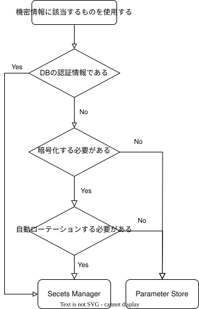

  

    目次
  

  {: .text-delta }

  - TOC
  {:toc}

---

# 機密情報を扱う時の利用方法  
機密情報に該当するもの（DBの認証情報など）を扱う時に利用する、[Secrets Manager](https://docs.aws.amazon.com/ja_jp/secretsmanager/latest/userguide/intro.html){:target="_blank"} と [Parameter Store](https://docs.aws.amazon.com/ja_jp/systems-manager/latest/userguide/systems-manager-parameter-store.html){:target="_blank"}についての比較と、使用方法について記載します。  
要件に合わせてどちらを扱うか判断し、利用してください。  

## 結論  

{: .note}  
DBの認証情報など、機密情報度合が高いものについては原則として、Secrets Managerを使用してください。  
後述のワークフローでも記載がある通り、自動ローテーションが必要なものについてはSecrets Manager、自動ローテーションしないものについては料金の安いParameter storeを使用してください。  

《ユースケース》  
- Secrets Manager  
    - RDSのDBパスワード管理
    - 外部APIキーの安全な保存と更新
    - アプリケーションの認証情報の集中管理
- Parameter Store  
    - アプリケーションの環境設定（例：/prod/db/host）
    - CI/CDパイプラインでの構成値の管理
    - 機密性の低い設定値の保存

《優位性》  
- Secrets Manager  
    - 自動ローテーション：DB認証情報などを定期的に更新する必要がある場合に最適
    - セキュリティ重視：アクセスログやタグ管理がしやすく、監査にも強い
    - Lambda連携：ローテーション処理を自動化できる
- Parameter Store  
    - コスト効率：標準パラメータは無料で利用可能
    - 設定管理：環境変数や構成情報の管理に適している
    - 階層構造：パラメータ名に階層を持たせて整理可能

《比較表》  

|  | Secrets Manager | Parameter Store(standard) | Parameter Store(advanced) |  
| --- | --- | --- |  --- |
| 暗号化 | 可能(KMS) | 可能(KMS) | 可能(KMS) |
| パラメータ（1つのシークレット）ごとの料金 | 0.40USD/月 | 追加料金なし | 0.05 USD |    
| API使用料金 | 1万回ごとに 0.05 USD | 追加料金なし | 1万回ごとに 0.05 USD |  
| 自動ローテーション | 可 | 不可 | 不可 |  
| アクセス制御 | IAMで可能 | IAMで可能 | IAMで可能 |  

《フローチャート》  
  
  

## Secrets Manager の機能  
### シークレットの保存と管理  
Secrets Manager は、セキュリティが重要な情報を暗号化して保存し、必要に応じてアクセスを提供します。AWS KMS（Key Management Service）を使用してシークレットを暗号化することで、データの安全性を確保します。  

### 自動ローテーション  
シークレットを定期的に変更することはセキュリティのベストプラクティスです。  
Secrets Manager は、特定のスケジュールに基づいてシークレットを自動的にローテーション（更新）する機能を提供します。これにより、セキュリティリスクを低減し、シークレットの管理を自動化できます。  

### バージョン管理   
シークレットの変更履歴を追跡し、以前のバージョンのシークレットにアクセスすることができます。これにより、変更が原因で問題が発生した場合に、簡単に以前の状態に戻すことが可能です。  

### アクセス制御  
AWS Identity and Access Management (IAM) と連携して、シークレットへのアクセス権限を細かく制御できます。これにより、シークレットへのアクセスを必要なユーザーやサービスに限定することができます。  

### 監査とモニタリング  
AWS CloudTrail と統合することで、シークレットへのアクセスや変更を監視し、ログを記録できます。これにより、コンプライアンス要件を満たすための監査証跡を確保できます。  

### クロスアカウントアクセス  
Secrets Manager は、AWS アカウント間でシークレットを共有する機能も提供します。これにより、複数のアカウントが同じシークレットを使用する場合に、それらを一元的に管理できます。  

## Parameter Store の機能  
### パラメータの保存と階層化  
パラメータストアでは、構成データや秘密情報をパラメータとして保存できます。これらのパラメータは階層的に整理することができ、例えば /application/production/database/password のようなパスを使用して整理されます。  

### セキュアな情報の暗号化  
機密性の高い情報は、AWS Key Management Service (KMS) を使用して暗号化されます。これにより、パスワードやデータベース接続文字列などの秘密情報が保護されます。  

### バージョン管理  
パラメータの各変更をバージョンとして保存します。これにより、過去のバージョンに簡単に戻すことができ、変更管理が容易になります。  

### アクセス制御  
AWS Identity and Access Management (IAM) との統合により、個々のパラメータへのアクセスを制御できます。特定のユーザーやロールがパラメータにアクセスできるように設定することが可能です。  

### 監査とモニタリング  
AWS CloudTrail との統合により、パラメータストアへのアクセスやパラメータの変更に関する監査ログを取得できます。これにより、コンプライアンスとセキュリティの監視が強化されます。  