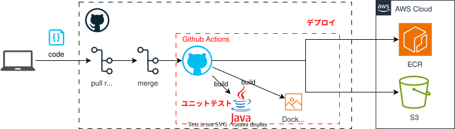

# CICDテンプレート利用ガイド

## 前提
[デプロイ戦略](/deploy/strategy){: target="_blank"} が定義済みであること。

## 概要
CICDテンプレートでは、`Github Actions`を利用して主にContinuous Delivery（CD）を示します。  
詳細は、[Github Actionsを理解する](https://docs.github.com/ja/actions/about-github-actions/understanding-github-actions)を参照してください。  

{: .note}  
電通総研では、XI部がGithub Actionsの費用を負担しており、  
申請不要で利用することが出来ます。  

