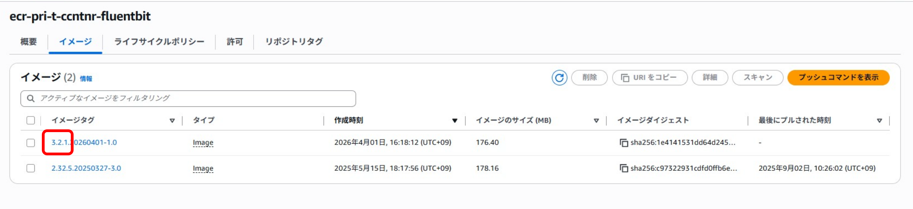

# Fluent Bit（DGCP標準）利用ガイド

## 移行ガイド（2.x系から3.x系）

{: .important}  
Fluent Bitの2.x系に利用しているCloudWatch Logsに使用しているプラグインなどが将来Deprecatedとなるため、  
環境移行など以前作成した設定ファイルでの対応となる場合にのみ、こちらの方法でCloudWatch Logsの設定を行ってください。  
また旧バージョンを使用している場合、アプリのリリースタイミングなどでコンテナの更新タイミングに併せて3.x系への切り替え対応を推奨します。  

### CloudWatch Logsの新プラグインへの移行方法  
1. 移行方法はまず、CloudWatch Logsへの出力設定の内容を新プラグイン向けに変更します。
1. `apl_output_cloudwatch.conf`の設定内容を下記サンプルを元に設定を変更します。  
<br>

旧バージョンでの設定内容  
```sh
# apl_output_cloudwatch.conf
[OUTPUT]		
    Name   cloudwatch		
    Match  api-trace-log		
    region ${AWS_REGION}		
    log_group_name ${LOG_GROUP_NAME}		
    log_stream_name api-trace-log/$(ecs_task_id)		
```

（変更箇所）  
[Name]の値を`cloudwatch`から`cloudwatch_logs`に変更します。  
[log_stream_name]の値を`api-trace-log`に変更します。  
[log_stream_template]の値に`api-trace-log/$ecs_task_id`を設定し、項目を追加します。  

新バージョンでの設定内容  
```sh
# apl_output_cloudwatch.conf
[OUTPUT]		
    Name   cloudwatch_logs		
    Match  api-trace-log		
    region ${AWS_REGION}		
    log_group_name ${LOG_GROUP_NAME}		
    log_stream_name api-trace-log		
    log_stream_template api-trace-log/$ecs_task_id
```
{: .note}  
`apl-trace-log`の名前は任意  

※log_stream_templateで(ecs-task-id)を取得出来なかった場合api-trace-log/のフォールバック用として  
log_stream_nameも併せて記載が必要です。  

<br>

### 設定ファイルの配置  
1. Fluent Bitの設定ファイルが配置してあるS3に変更した`apl_output_cloudwatch.conf`をアップロードして下さい。

<br>


### BaseImageの更新  
1. Fluent BitのBaseImageを`3.X.X`以上に更新し、ECSサービスを再起動をしてください。再起動後、cloudwatchにログが送信されます。

  
<br>

<br><br>

<p style="margin-top: 20em"></p>  

<div style="display: flex; justify-content: space-between;">
  <div style="text-align: center;">
    <a href="/deploy/fluentbit/introduction">←4.Fluent Bit（DGCP標準）旧バージョン2.x系の設定ファイルと出力</a>
  </div>
  <div style="text-align: center;">
　　<a href="/deploy/fluentbit/firelens">6.トラブルシュート→</a>
  </div>
</div>


