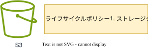

## 目的

`電通Security Policy（システムチェックシート等）`では、`13ヶ月`のログ保管を求められるため、  
ライフサイクルポリシーやストレージクラスを標準化し、ログ保管先として最適なアーカイブ用の`s3`のテンプレートを提供します。

## 概要図 
 
  
  
 

## 提供テンプレート(CloudFormation)

| ファイル名 | 用途 | 保存先 (S3 URL) | 
| --- | --- | --- |
| [archive-s3-template.yml](https://ap-northeast-1.console.aws.amazon.com/cloudformation/home?region=ap-northeast-1#/stacks/quickcreate?templateURL=https://dgcp-container-guide-311141522354.s3.ap-northeast-1.amazonaws.com/deploy/infrastructure/files/template/archive-s3-template.yml){: target="_blank"} | アーカイブ用S3バケットの構築 | `https://dgcp-container-guide-311141522354.s3.ap-northeast-1.amazonaws.com/deploy/infrastructure/files/template/archive-s3-template.yml` |
{: .note}  
DGCPのAWSへログインした状態でymlリンクを開き、以下パラメータを入力/変更してください。  

## 入力パラメータ
### Project Configuration

| パラメータ名 | 必須項目 | デフォルト値 | 説明 | 
| --- | --- | --- | --- |
| SystemId | 〇 | - | 実行するシステム識別子を入力 |  
| EnvType | 〇 | - | [環境種別](/faq/dgcp_environment.html){:target="_blank"}を選択 |  
| BillingID | 〇 | - | 請求IDを入力 |  

### S3 Configuration

| パラメータ名 | 必須項目 | デフォルト値 | 説明 | 
| --- | --- | --- | --- |
| BucketNameSuffix | - | `log-archive` | S3バケットのSuffixを入力 |
| S3StorageClass | - | `STANDARD_IA` | [S3のストレージクラス](https://aws.amazon.com/jp/s3/storage-classes/){:target="_blank"}を入力 |
| S3TransitionDate | - | `90` | 経過日数に伴うストレージクラスへの移行日を入力 |
| S3ExpireDate | - | `403` | 経過日数に伴うオブジェクトの削除日 `31days * 13month = 403days` |

{: .tip}  
ストレージクラスは、[参考チャート](https://dev.classmethod.jp/articles/should_i_choice_s3_storage_class_2023/#toc-s3-1){: target="_blank"} を元に変更してもOKです。  

{: .warning}  
既存環境に同じ名前のS3がある場合、サフィックスを変更してください。

### KMS Configuration

| パラメータ名 | 必須項目 | デフォルト | 説明 |  
| --- | --- | --- | --- |
| KMSKeyArn | - | - | KMSKeyのARNを入力 |  

{: .tip}  
・DGCPのKMSキー`<AWSアカウントID>-kms`  
・各担当者でKMSキー`要作成`  
どちらかのKMSキーで暗号化してください。  

{: .important}  
KMS暗号化は、情報区分「`極秘・取り扱い厳重注意`」時のみ必須となります。  

## 出力リソース

| リソース種別 | 出力例 |
| --- | --- |
| S3 Bucket | s3-`環境種別`-`システム識別`-`任意の名前` |
| S3 LifeCycle Policy | `TransitionIn`-`ストレージクラス`-`移行日`Days |
| S3 LifeCycle Policy | `ExpirationIn`-`オブジェクト削除日`Days |