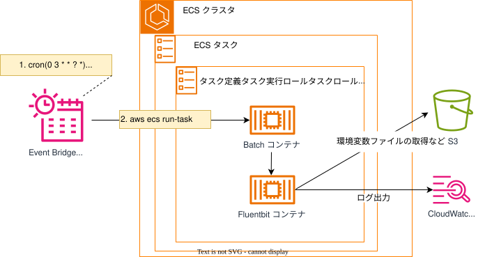

## 目的
本テンプレートは、ECS Fargate上でバッチ処理を実行するためのインフラ構成を提供します。  
EventBridge Schedulerを使用して、指定したスケジュール（Cron式）でECSタスクを定期実行することができます。  
担当者はパラメータ入力のみ実施すれば、ECSタスク定義、IAMロール、EventBridge Schedulerを構築できます。

## 概要図
<br>


<br>


## 提供テンプレート(CloudFormation)

| ファイル名 | 用途 | 保存先<br>(S3 URL) |
| --- | --- | --- |
| [batch-template.yml](https://ap-northeast-1.console.aws.amazon.com/cloudformation/home?region=ap-northeast-1#/stacks/quickcreate?templateURL=https://dgcp-container-guide-311141522354.s3.ap-northeast-1.amazonaws.com/deploy/infrastructure/files/template/batch-template.yml){: target="_blank"} | ECSバッチ(EventBridge Scheduler)テンプレート | `https://dgcp-container-guide-311141522354.s3.ap-northeast-1.amazonaws.com/deploy/infrastructure/files/template/batch-template.yml` |

{: .note}  
DGCPのAWSへログインした状態でymlリンクを開き、以下パラメータを入力/変更してください。


## 入力パラメータ
### Project Configuration

| パラメータ名 | 必須項目 | デフォルト | 説明 |
| --- | --- | --- | --- |
| SystemId | 〇 | - | 実行するシステム識別子を入力（6文字） |
| EnvType | 〇 | - | [環境種別](/faq/dgcp_environment.html){:target="_blank"}を選択 |
| BillingID | 〇 | - | 請求IDを入力 |  
| SecurityGroupIds | 〇 | - | [セキュリティグループ](/flow/#req3){:target="_blank"}を選択 |   

### Cluster Configuration  

| パラメータ名 | 必須項目 | デフォルト | 説明 |  
| --- | --- | --- | --- |  
| ClusterNameSuffix | - | bat01 | 作成されるECSクラスター名のSuffixを入力 |  

### Batch Configuration

| パラメータ名 | 必須項目 | デフォルト | 説明 |
| --- | --- | --- | --- |
| BatchNameSuffix | - | batch01 | バッチ名のSuffixを入力（例：batch01）<br>タスク定義、IAMロール、スケジューラ等の名前に使用されます |
| ContainerImageUri | 〇 | - | ECRイメージURIを入力 |
| TaskCpu | - | 512 | Fargateタスクに割り当てるCPUユニット数を選択<br>（256/512/1024/2048/4096） |
| TaskMemory | - | 1024 | Fargateタスクに割り当てるメモリ容量(MiB)を選択<br>（512/1024/2048/4096/8192/16384） |

### S3 Configuration

| パラメータ名 | 必須項目 | デフォルト | 説明 |  
| --- | --- | --- | --- |
| BucketNameSuffix | 〇 | fsv-batch | S3バケットのSuffixを入力 |  

{: .warning}  
既存環境に同じ名前のS3がある場合、サフィックスを変更してください。  

{: .note}  
FireLensからのログの出力に関しては、[Fluent Bit（DGCP標準）利用ガイド](../fluentbit/){:target="_blank"}を参照してください。

### Scheduler Configuration

| パラメータ名 | 必須項目 | デフォルト | 説明 |
| --- | --- | --- | --- |
| ScheduleState | - | DISABLED | スケジュールの初期状態を選択<br>（ENABLED/DISABLED） |
| ScheduleCronExpression | - | cron(0 3 * * ? *) | スケジュールのCron式を入力<br>（例：cron(0 3 * * ? *) = 毎日3:00） |
| ScheduleTimezone | - | Asia/Tokyo | スケジュールのタイムゾーンを入力<br>（例：Asia/Tokyo, UTC） |
| SchedulerInputJson | - | (下記参照) | ECSタスク実行時のオーバーライド設定をJSON形式で入力 |

**SchedulerInputJson サンプル値:**
```json
{
 "containerOverrides": [
  {
    "name": "batch01",
    "command": [
        "daily_report"
    ]
  }
 ]
}

```  

{: .important}
`SchedulerInputJson` 内の `"name"` は、`BatchNameSuffix` パラメータの値と一致している必要があります。

{: .note}
ScheduleStateはデフォルトで`DISABLED`（無効）になっています。  
スケジュール実行を開始する場合は、デプロイ後にAWSコンソールから`ENABLED`に変更するか、パラメータで`ENABLED`を指定してください。  

### Logs Configuration

| パラメータ名 | 必須項目 | デフォルト | 説明 |
| --- | --- | --- | --- |
| LogsRetentionInDays | - | 30 | ログの保持期間を入力 |

### KMS Configuration

| パラメータ名 | 必須項目 | デフォルト | 説明 |
| --- | --- | --- | --- |
| KMSKeyArn | - | - | KMSKeyのARNを入力<br>（空欄の場合は暗号化なし） |

{: .tip}
・DGCPのKMSキー`<AWSアカウントID>-kms`  
・各担当者でKMSキー`要作成`  
どちらかのKMSキーで暗号化してください。

{: .important}
KMS暗号化は、情報区分「`極秘・取り扱い厳重注意`」時のみ必須となります。


## 出力リソース

| リソースの種類 | 出力例 |
| --- | --- |
| S3バケット | s3-t-ccntnt-fsv-batch |  
| ECSクラスター | ecs-cluster-t-ccntnt-bat01 |
| タスク定義 | ecs-task-t-ccntnt-batch01 |
| CloudWatch Logs | /ecs/ecs-task-t-ccntnt-batch01 |
| EventBridge Scheduler | ebschdlr-t-ccntnt-batch01 |
| スケジューラ実行ロール | rol-t-ccntnt-scheduler-batch01 |
| タスク実行ロール | rol-t-ccntnt-taskexecute-batch01 |
| タスクロール | rol-t-ccntnt-task-batch01 |

{: .note}
出力例は、下記の入力パラメータを設定した場合に出力される値です。

| パラメータ名 | 値 |
| --- | --- |
| SystemId | ccntnt |
| EnvType | t |
| BatchNameSuffix | batch01 |


## その他必要な作業について

1. バッチコンテナを作成する場合　→　[ベースイメージでのイメージビルド > バッチコンテナの作成](../../docker/official/batchContainer.html){:target="_blank"}  
1. ECR（Dockerイメージ格納用リポジトリ）を作成する場合　→　[手動デプロイガイド > ECRの構築手順](/deploy/manual/ecr-construction.html){:target="_blank"} or [インフラテンプレート > ECRテンプレート](/deploy/infrastructure/ecr.html){:target="_blank"}  
1. 手動デプロイを行う場合　→　[手動デプロイガイド > ECSバッチの構築手順](../manual/deploy-batch.html){:target="_blank"}  
1. CICDを構成する場合　→　[CICDテンプレート利用ガイド](/deploy/cicd/){:target="_blank"}  
1. S3にもログ出力する場合　→　[Fluent Bit（DGCP標準）利用ガイド>設定ファイルと出力](/deploy/fluentbit/configuration.html){:target="_blank"}  