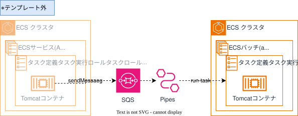

## 目的  
業務系個別環境基盤では、アプリ側のアプリケーションアーキテクチャに基づき、インフラ構築を行うことを前提としたプラットフォームとなっています。  
しかし一方で、従来インフラ構築をDGCPへお任せ頂いていたため、難しい部分もある認識です。  
従って、担当者が必要な構成要素をパラメータの入力のみでインフラ構築できる、DCフレームワークの非同期処理を実現するためのテンプレートを提供します。  

{: .note}  
・DCフレームワークは、 [DCフレームワークガイドライン](https://dc-framework-guideline.dentsu.jp/index.html){:target="_blank"}  
を参照してください。 

## 概要図


{: .note}  
ECSサービス（API）は、Webテンプレート等で作成した稼働中のAPIコンテナを想定しております。  
本テンプレートで作成されるのは、`SQS` `EventBridge Pipes` `ECSバッチ（Async）`の3種類となり、作成されません。  
ご留意ください。  


## 提供テンプレート(CloudFormation)  

| ファイル名 | 用途 | 保存先 <br>(S3 URL) |  
|-----------------|------|--------------------|  
| [dcfw-web-async-template.yml](https://ap-northeast-1.console.aws.amazon.com/cloudformation/home?region=ap-northeast-1#/stacks/quickcreate?templateURL=https://dgcp-container-guide-311141522354.s3.ap-northeast-1.amazonaws.com/deploy/infrastructure/files/template/dcfw-async-template.yml){: target="_blank"} | DCFW 非同期処理テンプレート | `https://dgcp-container-guide-311141522354.s3.ap-northeast-1.amazonaws.com/deploy/infrastructure/files/template/dcfw-async-template.yml` |

{: .note}  
DGCPのAWSへログインした状態でymlリンクを開き、以下パラメータを入力/変更してください。  

## 入力パラメータ
### Project Configuration

| パラメータ名 | 必須項目 | デフォルト | 説明 |  
| --- | --- | --- | --- |
| SystemId | 〇 | - | 実行するシステム識別子を入力 |  
| EnvType | 〇 | - | [環境種別](/faq/dgcp_environment.html){:target="_blank"}を選択 |  
| BillingID | 〇 | - | 請求IDを入力 | 
| SecurityGroupIds | 〇 | - | [セキュリティグループ](/flow/#req3){:target="_blank"}を選択 |   

### ECS Configuration  

| パラメータ名 | 必須項目 | デフォルト | 説明 |  
| --- | --- | --- | --- |  
| AsyncJobNameSuffix | - | async-job | 非同期処理リソースのSuffixを入力 |  
| ECSCapacityProvider | - | FARGATE_SPOT | ECSクラスタのキャパシティ戦略　※後述 |  
| AsyncJobECSTaskCPUUnit | - | 1024 | タスクのCPUユニット数を入力  |  
| AsyncJobECSTaskMemory | - | 2048 | タスクのメモリ容量を入力 |  

### Logs Configuration

| パラメータ名 | 必須項目 | デフォルト | 説明 |  
| --- | --- | --- | --- |
| LogsRetentionInDays | - | 30 | ログの保持期間を入力 |  

### KMS Configuration

| パラメータ名 | 必須項目 | デフォルト | 説明 |  
| --- | --- | --- | --- |
| KMSKeyArn | - | - | KMSKeyのARNを入力 |  

{: .tip}  
・DGCPのKMSキー`<AWSアカウントID>-kms`  
・各担当者でKMSキー`要作成`  
どちらかのKMSキーで暗号化してください。  

{: .important}  
KMS暗号化は、情報区分「`極秘・取り扱い厳重注意`」時のみ必須となります。  


## 出力リソース

| リソースの種類 | 出力例 |
| --- | --- |
| ECSクラスタ | ecs-cluster-t-ccntnt-async-job |  
| タスク実行ロール | rol-t-ccntnt-taskexecute-async-job |  
| タスクロール | rol-t-ccntnt-task-async-job |  
| タスク定義 | ecs-task-t-ccntnt-async-job |  
| CloudWatchLogs(Web) | /ecs/ecs-task-t-ccntnt-async-job |  
| EventBridge Pipes | ebpipes-t-ccntnt-async-job |  
| IAMロール（Pipes） | rol-t-ccntnt-async-job-pipeexecutuion |  
| CloudWatchLogs(Web) | /aws/vendedlogs/pipes/ebpipes-t-ccntnt-async-job |  
| SQS | sqs-t-ccntnt-task-async-job |  
| SQS(DLQ) | sqs-t-ccntnt-task-async-job-dlq |  


{: .note}  
出力例は、下記の入力パラメータを設定した場合に出力される値です。
  
| パラメータ名 | 値 |  
| --- | --- |
| SystemId | ccntnt |  
| EnvType | t |  

## EventBridge Pipesの利用について
* ECS Clusterのキャパシティ戦略は、`FARGATE_SPOT`を利用しています。
    * Fargateをスポット（短期間）的に利用する場合、7割引きの価格で利用できる仕組みとなります。  
    * AWSの都合でいつタスクが停止するかわからないため、長期間(目安12時間程度)処理する場合は、`FARGATE`へ変更してください。  
        * 事例としては、[電通総研テックブログ](https://tech.dentsusoken.com/entry/2023/06/16/Fargate_Spot%E3%82%92%E9%96%8B%E7%99%BA%E7%B3%BB%E3%81%AE%E7%92%B0%E5%A2%83%E3%81%A7%E4%BD%BF%E7%94%A8%E3%81%99%E3%82%8B){: target="_blank"}を参照してください。  
    * 但し、停止される場合であっても、通常通り`StopTimeout`の値が適用されます（最大120秒）。
        

* PipesからECSタスクを実行する際は、`ContainerOverrides（上書き実行）`を利用しています。  
    * 上書き実行できる項目は、[RunTask API](https://docs.aws.amazon.com/ja_jp/AmazonECS/latest/APIReference/API_RunTask.html){: target="_blank"}  を参照してください。
    * テンプレートでは、`Command`で実行するアプリを変更し、`Environment（環境変数）`でSQSに渡されたメッセージをコンテナに渡すようにしています。  
        * メッセージを`Command`の`第三引数`として渡すことも可能です。
        ```
        Overrides:
            ContainerOverrides:
              - Name: !Ref AsyncJobNameSuffix
                Command: 
                  - python
                  - ./app.py
                Environment:
                  - Name: PAYLOAD
                    Value: $
        ```

{: .tip}  
<u>~ ContainerOverridesの注意点 ~</u>  
`A total of 8192 characters are allowed for overrides. This limit includes the JSON formatting characters of the override structure.`  
と記載の通り、8192文字以上の上書き実行はできません。  
必要な場合は別途、S3へ処理内容を出力し、アプリからはS3の処理内容を取得して実行するなど、対応を検討してください。  
