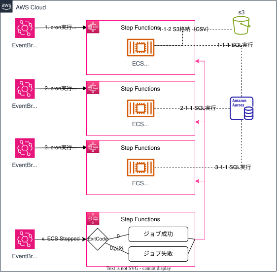

---
title: Jobテンプレート
last_modified_date: "2025-04-08"
parent: DCフレームワーク
nav_order: 2
---  

## 目的  
本テンプレートは、担当者がDCフレームワークで必要な構成要素をパラメータ入力のみで構築できるサーバレスJobテンプレートのサンプル※です。   
`ECS`及び`StepFunctions`を利用したJob環境の構築を行います。  

{: .important}  
コンテナ×StepFunctionsのサーバレスJobの動作サンプルとして提供しています。  
各アプリごとのジョブ処理、ワークフローに応じて変更してください。

{: .note}  
`Senju`構成のテンプレートは、EC2が依存関係となるため、未提供となります。  
システム要件により`Senju`利用が必要な場合は、DGCP CoEへお問い合わせください。  

## 概要図

## 提供テンプレート(CloudFormation)  

| ファイル名 | 用途 | 保存先  (S3 URL) |  
|-----------------|------|--------------------|  
| [dcfw-serverless-job-template.yml ](https://ap-northeast-1.console.aws.amazon.com/cloudformation/home?region=ap-northeast-1#/stacks/quickcreate?templateURL=https://dgcp-container-guide-311141522354.s3.ap-northeast-1.amazonaws.com/deploy/infrastructure/files/template/dcfw-serverless-job-template.yml){: target="_blank"} | DCFW Jobテンプレート | `https://dgcp-container-guide-311141522354.s3.ap-northeast-1.amazonaws.com/deploy/infrastructure/files/template/dcfw-serverless-job-template.yml` |

{: .note}  
DGCPのAWSへログインした状態でymlリンクを開き、以下パラメータを入力/変更してください。  

## 入力パラメータ
### Project Configuration

| パラメータ名 | 必須項目 | デフォルト | 説明 |  
| --- | --- | --- | --- |
| SystemId | 〇 | - | 実行するシステム識別子を入力 |  
| EnvType | 〇 | - | [環境種別](/faq/dgcp_environment.html){:target="_blank"}を選択 |  
| BillingID | 〇 | - | 請求IDを入力 | 
| SecurityGroupIds | 〇 | - | [セキュリティグループ](/flow/#req3){:target="_blank"}を選択 |   

### Job Configuration 

| パラメータ名 | 必須項目 | デフォルト | 説明 |  
| --- | --- | --- | --- |  
| JobNameSuffix | - | job | job名を入力 |  
| ClusterNameSuffix | - | webapp | ECSクラスター名を入力 |  
| S3BucketName | 〇 | - | データ連携用バケット名を選択  `既に存在するS3バケット名を入力(例: s3-t-didcfw-fsv-01)` |  

### Job1 Configuration  

| パラメータ名 | 必須項目 | デフォルト | 説明 |  
| --- | --- | --- | --- |  
| JsonParams1 | - | {"CommandParams": ["--spring.batch.job.name=purchaseOrderOutputJob", "orderDate=2024-01-01"]} | jobコマンドパラメータ1を入力 |  
| ScheduleExpressionParam1 | - | cron(0 0 * * ? *) | Cron形式(Asia/Tokyo)のスケジュール1を入力 |  

### Job2 Configuration

| パラメータ名 | 必須項目 | デフォルト | 説明 |  
| --- | --- | --- | --- |  
| JsonParams2 | - | {"CommandParams": ["--spring.batch.job.name=dummyBinningJob", "orderDate=2024-01-01"]} | jobコマンドパラメータ2を入力 |  
| ScheduleExpressionParam2 | - | cron(10 0 * * ? *) | Cron形式(Asia/Tokyo)のスケジュール2を入力 |  

### Job3 Configuration

| パラメータ名 | 必須項目 | デフォルト | 説明 |  
| --- | --- | --- | --- |  
| JsonParams3 | - | {"CommandParams": ["--spring.batch.job.names=dummyShippingJob"]} | jobコマンドパラメータ3を入力 |  
| ScheduleExpressionParam3 | - | cron(20 0 * * ? *) | Cron形式(Asia/Tokyo)のスケジュール3を入力 |  

{: .note}   
[Step Functions](https://docs.aws.amazon.com/step-functions/latest/dg/welcome.html)の詳細は公式ドキュメントを参照してください

### Logs Configuration

| パラメータ名 | 必須項目 | デフォルト | 説明 |  
| --- | --- | --- | --- |
| LogsRetentionInDays | - | 30 | ログの保持期間を入力 |  

### KMS Configuration

| パラメータ名 | 必須項目 | デフォルト | 説明 |  
| --- | --- | --- | --- |
| KMSKeyArn | - | - | KMSKeyのARNを入力 |  

{: .tip}  
・DGCPのKMSキー`<AWSアカウントID>-kms`  
・各担当者でKMSキー`要作成`  
どちらかのKMSキーで暗号化してください。  

{: .important}  
KMS暗号化は、情報区分「`極秘・取り扱い厳重注意`」時のみ必須となります。  

## 出力リソース

| リソースの種類 | 出力例 |
| --- | --- |
| StepFunctions標準ステートマシン（job） | StateMachine-t-ccntnt-job |  
| StepFunctions標準ステートマシン（job結果連携） | StateMachine-t-ccntnt-sendtaskresult |  
| EventBridge Rule | ebrule-t-ccntnt-sendtaskresult |  
| EventBridge Scheduler | ebschdlr-t-ccntnt-job-purchaseOrderOutput |  
| EventBridge Scheduler | ebschdlr-t-ccntnt-job-dummyBinning |  
| EventBridge Scheduler | ebschdlr-t-ccntnt-job-dummyShipping |  
| EventBridge Rule用IAMロール | rol-t-ccntnt-states-job-sendtaskresult |  
| ステートマシン（job）用IAMロール | rol-t-ccntnt-states-job |  
| ステートマシン（job結果連携）用IAMロール  | rol-t-ccntnt-states-sendtaskresult |  
| CloudWatchLogs | /ecs/ecs-task-t-ccntnt-job |  
| タスク定義 | ecs-task-t-ccntnt-job |  
| タスク実行ロール | rol-t-ccntnt-taskexecute-job |  
| タスクロール | rol-t-ccntnt-task-job |  

{: .note}  
出力例は、下記の入力パラメータを設定した場合に出力される値です。
  
| パラメータ名 | 値 |  
| --- | --- |
| SystemId | ccntnt |  
| EnvType | t |  