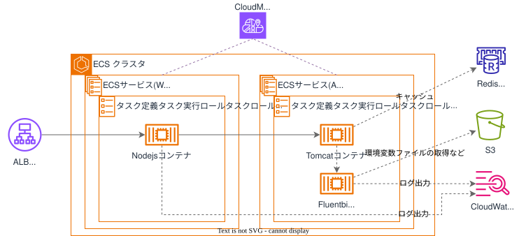
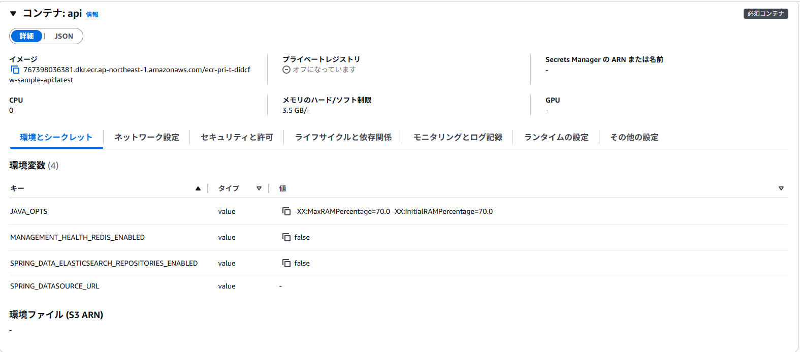

## 目的  
業務系個別環境基盤では、アプリ側のアプリケーションアーキテクチャに基づき、インフラ構築を行うことを前提としたプラットフォームとなっています。  
しかし一方で、従来インフラ構築をDGCPへお任せ頂いていたため、難しい部分もある認識です。  
従って、担当者がDCフレームワークで必要な構成要素をパラメータの入力のみでインフラ構築できる、SPAのWebアプリケーション（DBを除く）のテンプレートを提供します。  

{: .note}  
・DBは、 [データベース利用ガイドライン](https://dgcp-db-guideline.dentsu.jp/){:target="_blank"}  
・DCフレームワークは、 [DCフレームワークガイドライン](https://dc-framework-guideline.dentsu.jp/index.html){:target="_blank"}  
を参照してください。 

## 概要図

## 提供テンプレート(CloudFormation)  

| ファイル名 | 用途 | 保存先  (S3 URL) |  
|-----------------|------|--------------------|  
| [dcfw-web-infra-template.yml](https://ap-northeast-1.console.aws.amazon.com/cloudformation/home?region=ap-northeast-1#/stacks/quickcreate?templateURL=https://dgcp-container-guide-311141522354.s3.ap-northeast-1.amazonaws.com/deploy/infrastructure/files/template/dcfw-web-infra-template.yml){: target="_blank"} | DCFW Webテンプレート | `https://dgcp-container-guide-311141522354.s3.ap-northeast-1.amazonaws.com/deploy/infrastructure/files/template/dcfw-web-infra-template.yml` |

{: .note}  
DGCPのAWSへログインした状態でymlリンクを開き、以下パラメータを入力/変更してください。  

## 入力パラメータ
### Project Configuration

| パラメータ名 | 必須項目 | デフォルト | 説明 |  
| --- | --- | --- | --- |
| SystemId | 〇 | - | 実行するシステム識別子を入力 |  
| EnvType | 〇 | - | [環境種別](/faq/dgcp_environment.html){:target="_blank"}を選択 |  
| BillingID | 〇 | - | 請求IDを入力 | 
| SecurityGroupIds | 〇 | - | [セキュリティグループ](/flow/#req3){:target="_blank"}を選択 |   

### ELB Configuration

| パラメータ名 | 必須項目 | デフォルト | 説明 |  
| --- | --- | --- | --- |
| ACM | 〇 | - | [ACM証明書](https://ap-northeast-1.console.aws.amazon.com/acm/home?region=ap-northeast-1#/certificates/list){:target="_blank"}のARNを入力  |  
| WebHealthCheckPath | - | /health | Webコンテナのヘルスチェックパスを入力 |  
| Stickiness | - | false | Sticky Sessionの利用有無を入力 |  
| IdleTimeoutSeconds | - | 360 | アイドル接続状態解除までの時間（秒）を入力 |  

{: .tip}  
ACM証明書は、事前に[コンテナ利用フロー > 非本番環境の構築 > ACM証明書の発行](/flow/#req4){:target="_blank"}を参照し、ACM証明書の発行とDNS申請を行ってください。  
DGCP初期構築として払い出される構築検証用のACM`<AWSアカウントエイリアス名>.dentsu.co.jp`を利用することも出来ます。  

### ELB OIDC Configuration

| パラメータ名 | 必須項目 | デフォルト | 説明 |  
| --- | --- | --- | --- |
| OIDCIssuerURL | - | - | OIDCプロバイダのIssuer（発行元）のURLを入力  入力した場合は、  ・`*/health*`パスを認証除外  ・それ以外を認証必須のパス  ・デフォルトのアクションを403Deny のルールを持った状態でALBを作成  入力しない場合は、認証なしALBを作成 |  
| OIDCAuthorizationEndpoint | - | - | OIDCプロバイダの認可エンドポイントを入力 |  
| OIDCTokenEndpoint | - | - | OIDCプロバイダのトークンエンドポイントを入力 |  
| OIDCUserInfoEndpoint | - | - | OIDCプロバイダのユーザ情報エンドポイントを入力 |  
| OIDCClientID | - | - | OIDCのアプリケーションとして払い出された`ClientId`を入力 |  
| OIDCClientSecret | - | - | OIDCのアプリケーションとして払い出された`ClientSecret`を入力 |  
| OIDCScope | - | openid profile | OIDCのスコープを入力 電通Oktaでは`profile`の指定がないと得られる情報が少ないため、デフォルト設定として追加 |  
| OIDCAuthExclusionHeader | - | Authorization | ALB認証の除外条件の１つとしてHTTPヘッダーを入力 PathとAND条件で動作する OIDCのシステム間連携を目的に設定 |
| OIDCAuthExclusionPath | - | /api | ALB認証の除外条件の１つとしてパスを入力 HeaderとAND条件で動作する OIDCのシステム間連携を目的に設定 |  
| OIDCAuthExclusionHealthCheckPath | - | /health | 認証なしでヘルスチェックパスへアクセスできる必要があるため、設定 例：）/healthが含まれるパスに認証なしでアクセスが可能となる |  

{: .warning}  
`OIDCIssuerURL``OIDCAuthorizationEndpoint``OIDCTokenEndpoint``OIDCUserInfoEndpoint`の入力の末尾に、`/(スラッシュ)`は含めないようにしてください。

### ECS Configuration  

| パラメータ名 | 必須項目 | デフォルト | 説明 |  
| --- | --- | --- | --- |  
| NamespaceId | 〇 | - | 非本番：`dev-<システム識別子>.local`  本番：`prd-<システム識別子>.local`  環境に合わせた [NamespaceID(ns-xxxxxxxxxx)](https://ap-northeast-1.console.aws.amazon.com/cloudmap/home/namespaces?region=ap-northeast-1){:target="_blank"} を入力 |  
| ClusterNameSuffix | - | webapp | ECSクラスター名のSuffixを入力 |  
| ContainerInsights | - | enabled | ContainerInsightsの`enhanced``enabled``disabled`を選択 メトリクス監視するためには`enabled`以上が必要 |  
| WebServiceNameSuffix | 〇 | web | Webサービス名のSuffixを入力 |  
| WebContainerPort | - | 31000 | Webappの待ち受けポートを入力 |  
| WebECSTaskCPUUnit | - | 512 | タスクのCPUユニット数を入力 |  
| WebECSTaskMemory | - | 1024 | タスクのメモリ容量を入力 |  
| WebDesiredCount | - | 1 | 維持したいタスク数を入力 |  
| ApiServiceNameSuffix | 〇 | api | ApiサービスのSuffixを入力 |  
| ApiContainerPort | - | 8080 | Apiコンテナの待ち受けポートを入力 |  
| ApiECSTaskCPUUnit | - | 2048 | ApiコンテナのCPU性能を入力 |  
| ApiECSTaskMemory | - | 4096 | Apiコンテナの利用メモリを入力 |  
| ApiHealthCheckPath | - | /actuator/health | Apiコンテナのヘルスチェックパスを入力 |  
| ApiDesiredCount | - | 1 | Apiサービスで維持したいタスク数を入力  `推奨値`  `非本番環境：1`  `本番環境または本番相当の環境：2`  `必要に応じて２以上の値を定義` |  

### Cache(Redis/Valkey) Common Configuration  

| パラメータ名 | 必須項目 | デフォルト | 説明 |  
| --- | --- | --- | --- |
| CacheEnabled | - | false | Redis/Valkey構築の有無（`true`、`false`）を選択 |  
| CacheEngine | - | valkey | キャッシュエンジン（`valkey`、`redis`）を選択 |  
| CacheMode | - | Serverless | デプロイモード（`Serverless`、`Provisioned`）を選択 |  
| CacheNameSuffix | - | cache | キャッシュ名(suffix)を入力 |  
| CachePort | - | 6379 | キャッシュポート番号を入力 |  
| CacheNodeVersion | - | - | キャッシュノードのエンジンバージョンを入力（Serverless: メジャーバージョン指定 [例: 9]、Provisioned: マイナーバージョンまで指定[例: 9.1]） |  

### Cache(Redis/Valkey) Serverless Configuration  

| パラメータ名 | 必須項目 | デフォルト | 説明 |  
| --- | --- | --- | --- |
| CacheMaxCapacityECPU | - | - | キャッシュの最大容量 ECPU を入力 |  
| CacheMaxCapacityMemory | - | - | キャッシュの最大容量 メモリ（GB）を入力 |  

### Cache(Redis/Valkey) Provisioned Configuration  

| パラメータ名 | 必須項目 | デフォルト | 説明 |  
| --- | --- | --- | --- |
| CacheNodeType | - | cache.t3.medium | キャッシュノードタイプを入力 |  
| CacheReplicaNodeNum | - | 0 | キャッシュレプリカノード数を入力（高可用性が必要な場合は1以上を推奨） |  
| CacheParameterGroupName | - | - | キャッシュノードパラメータグループ名を入力 |  

{: .note}  
`CacheParameterGroupName`は、アプリケーションの要求に応じてキャッシュノードのパラメータ（設定）をカスタマイズする場合、入力してください。  

### S3 Configuration

| パラメータ名 | 必須項目 | デフォルト | 説明 |  
| --- | --- | --- | --- |
| BucketNameSuffix | - | fsv-01 | S3バケットのSuffixを入力 |  

{: .warning}  
既存環境に同じ名前のS3がある場合、サフィックスを変更してください。

### Logs Configuration

| パラメータ名 | 必須項目 | デフォルト | 説明 |  
| --- | --- | --- | --- |
| LogsRetentionInDays | - | 30 | ログの保持期間を入力 |  

### KMS Configuration

| パラメータ名 | 必須項目 | デフォルト | 説明 |  
| --- | --- | --- | --- |
| KMSKeyArn | - | - | KMSKeyのARNを入力 |  

{: .tip}  
・DGCPのKMSキー`<AWSアカウントID>-kms`  
・各担当者でKMSキー`要作成`  
どちらかのKMSキーで暗号化してください。  

{: .important}  
KMS暗号化は、情報区分「`極秘・取り扱い厳重注意`」時のみ必須となります。  

## 出力リソース

| リソースの種類 | 出力例 |
| --- | --- |
| ALB | alb-t-ccntnt-int-web |  
| Target Group | alb-tg-t-ccntnt-int-web |  
| ECSクラスタ | ecs-cluster-t-ccntnt-webapp |  
| タスク実行ロール | rol-t-ccntnt-taskexecute |  
| ECSサービス(Web) | ecs-service-t-ccntnt-web |  
| タスク定義(Web) | ecs-task-t-ccntnt-web |  
| タスクロール(Web) | rol-t-ccntnt-task-web |  
| タスクロールポリシー(Web) | pol-t-ccntnt-task-web |  
| CloudWatchLogs(Web) | /ecs/ecs-task-t-ccntnt-web |  
| ECSサービス(Api) | ecs-service-t-ccntnt-api |  
| タスク定義(Api) | ecs-task-t-ccntnt-api |  
| タスクロール(Api) | rol-t-ccntnt-task-api |  
| タスクロールポリシー(Api) | pol-t-ccntnt-task-api |  
| CloudWatchLogs(Api) | /ecs/ecs-task-t-ccntnt-api |  
| S3 | s3-t-ccntnt-fsv-01 |  

{: .note}  
出力例は、下記の入力パラメータを設定した場合に出力される値です。
  
| パラメータ名 | 値 |  
| --- | --- |
| SystemId | ccntnt |  
| EnvType | t |  

## その他必要な作業について

1. アプリのコンテナイメージを作成する場合 → [ベースイメージでのイメージビルド](/docker/build.html){:target="_blank"}  
1. ECR（Dockerイメージ格納用リポジトリ）を作成する場合 → [手動デプロイガイド > ECRの構築手順](/deploy/manual/ecr-construction.html){:target="_blank"} or [インフラテンプレート > ECRテンプレート](/deploy/infrastructure/ecr.html){:target="_blank"}  
1. 手動デプロイを行う場合 → [手動デプロイガイド > ECSへのデプロイ](/deploy/manual/deploy-browser.html){:target="_blank"}  
1. CICDを構成する場合 → [CICDテンプレート利用ガイド](/deploy/cicd/){:target="_blank"}  
1. S3にもログ出力する場合 → [Fluent Bit（DGCP標準）利用ガイド>設定ファイルと出力](/deploy/fluentbit/configuration.html){:target="_blank"}  
  
を参照してください。

## インフラテンプレートで作成されたECSタスク定義の修正

まずは初回起動として、デフォルト起動すると、API側でエラーが発生します。  
※DCフレームワークのサンプルとしてDBやOpenSearch, Redis(Valkey)に接続しようと試みますが、接続先がないため  

従って下記の環境変数を用いて接続しないように、コンテナの挙動を変えています。  
アプリケーションのイメージに差し替える、DCFWのサンプルアプリを稼働させる場合には削除してください。  

{: .important}  
DCフレームワークのサンプルアプリケーションを動作させる場合は、`DB構築`
は最低限、必須となります。  
本テンプレートの対応外となりますので、DCフレームワーク担当の方へご確認ください。  

* `SPRING_DATASOURCE_URL=`
    * DBの接続先定義
    * DB関連の設定は、[SecretsManagerの利用](/deploy/secretsmanagement/secretsmanager){:target="_blank"}を参考に変更してください。
* `SPRING_DATA_ELASTICSEARCH_REPOSITORIES_ENABLED=false`
    * OpenSearchの有効化の定義
    * OpenSearchを有効化する場合は、削除してください。
* `MANAGEMENT_HEALTH_VALKEY_ENABLED=false`
    * Valkeyの接続先のヘルスチェックの有無
    * インフラテンプレート上で、データストア（Valkey/Redis）を作成すると、自動的に削除されます。手動で構築した場合などは、削除してください。
* `MANAGEMENT_HEALTH_REDIS_ENABLED=false`
    * Redisの接続先のヘルスチェックの有無
    * インフラテンプレート上で、データストア（Valkey/Redis）を作成すると、自動的に削除されます。手動で構築した場合などは、削除してください。