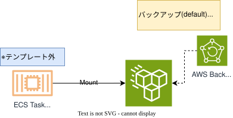

## 目的
コンテナ基盤では、ストレージとして、EFSを選択するケースも発生するため、EFSをデプロイするためのテンプレートを提供します。

## 概要図
 
  

 

## 提供テンプレート(CloudFormation)

| ファイル名 | 用途 | 保存先 (S3 URL) | 
| --- | --- | --- |
| [efs-template.yml](https://ap-northeast-1.console.aws.amazon.com/cloudformation/home?region=ap-northeast-1#/stacks/quickcreate?templateURL=https://dgcp-container-guide-311141522354.s3.ap-northeast-1.amazonaws.com/deploy/infrastructure/files/template/efs-template.yml){: target="_blank"} | EFSテンプレート | `https://dgcp-container-guide-311141522354.s3.ap-northeast-1.amazonaws.com/deploy/infrastructure/files/template/efs-template.yml` |

{: .note}  
DGCPのAWSへログインした状態でymlリンクを開き、以下パラメータを入力/変更してください。  

## 入力パラメータ
### Project Configuration

| パラメータ名 | 必須項目 | デフォルト | 説明 |  
| --- | --- | --- | --- |
| SystemId | 〇 | - | 実行するシステム識別子を入力 |  
| EnvType | 〇 | - | [環境種別](/faq/dgcp_environment.html){:target="_blank"}を選択 |  
| BillingID | 〇 | - | 請求IDを入力 | 
| SecurityGroupIds | 〇 | - | [セキュリティグループ](/flow/#req3){:target="_blank"}を選択 |   

### EFS Configuration

| パラメータ名 | 必須項目 | デフォルト | 説明 |  
| --- | --- | --- | --- |  
| FileSystemName | - | - | EFSのファイルシステム名を入力  |  
| ThroughputMode | - | elastic | `bursting｜provisioned｜elastic`から選択可能 elasticがEFSとしても標準 |  
| ProvisionedThroughputInMibps | - | - | `ThroughputMode:provisioned`の際に入力 `1~1024`の値を入力する。 |  
| TaskRoleName | 〇 | - | EFSをマウントするタスク定義で利用しているタスクロール名を入力 |  
| AccessPointEnabled | - | true | EFSのアクセスポイントの有無を選択 |
| AccessPointUid | - | 5001 | iaptom01usr(5001)を想定したデフォルト設定 ユーザIDを入力する |
| AccessPointGid | - | 500 | iaptom_grp(500)を想定したデフォルト設定 グループIDを入力する。 |  

### AWS Backup Configuration

| パラメータ名 | 必須項目 | デフォルト | 説明 |  
| --- | --- | --- | --- |  
| AWSBackupEnabled | - | false | EFSのバックアップ有無を選択。 |
| BackupTime | - | `cron(0 2 * * ? *)` | Cron式を入力 デフォルトは、`毎日 2時`にバックアップ |
| TimeZone | - | `Asia/Tokyo` | タイムゾーンを入力 |
| DeleteAfterDays | - | 31 | バックアップの保持期間を入力 デフォルトは、`31日間`保持後、削除 |

### KMS Configuration

| パラメータ名 | 必須項目 | デフォルト | 説明 |  
| --- | --- | --- | --- |
| KMSKeyArn | - | - | KMSKeyのARNを入力 |  

{: .tip}  
・DGCPのKMSキー`<AWSアカウントID>-kms`  
・各担当者でKMSキー`要作成`  
どちらかのKMSキーで暗号化してください。  

{: .important}  
KMS暗号化は、情報区分「`極秘・取り扱い厳重注意`」時のみ必須となります。  

## 出力リソース

| リソースの種類 | 出力例 |
| --- | --- |
| EFS FileSystem | dev-efs |  
| EFS FileSystem AccessPoint | dev-efs-defaultAP |  

{: .note}  
出力例は、下記の入力パラメータを設定した場合に出力される値です。
  
| パラメータ名 | 値 |  
| --- | --- |
| SystemId | ccntnt |  
| EnvType | t |
| FileSystemName | dev-efs |
| AccessPointEnabled | true |
| AWSBackupEnabled | false |

## EFSの設定に関して
* アクセスポイントについては、[EFSをECSにマウントする](/deploy/manual/efs-mount-to-ecs.html#アクセスポイント){: target="_blank"}を参照してください。  
* AWS Backupは、EFSのコンソールから自動設定する形で有効化することも可能です。
    * デフォルトは、`UTC 5:00（JST 14:00）, 35日間の保持期間`となります。
    * Backupの詳細カスタマイズ（バックアップボールド、プランなど）を行う場合は、本テンプレートでは、`false`。自動バックアップをコンソールから有効化してください。
* `ThroughputMode`はAWSの推奨として`elastic`となります。`provisioned`の際のパフォーマンスについては各チームにてご検討ください。  