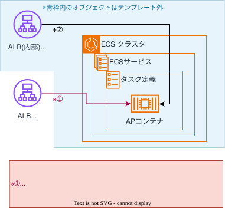
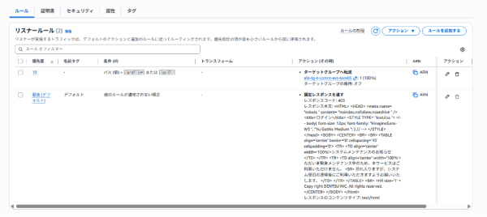

## 目的
アプリケーションの要件によっては必要となるインターネット向けALBのテンプレートを提供します。

## 概要図
<br>
  

<br>
{: .note}  
ターゲットグループに接続先のAPコンテナをターゲットとして登録する方法は、[FAQ > ECSサービスを複数のターゲットグループに登録する](faq/multi_targetg){:target="_blank"}の`既存のサービスに追加する`を参照してください。 

{: .important}  
aws ecs update-serviceコマンドでターゲットの登録を追加する場合は、パラメータ「load-balancers」のターゲットグループに  
必ず概要図の※➀と既存の※➁を指定してください。   
`また同コマンドを実行すると※➁のターゲット登録も再作成となるため、`  
`本番環境への反映かつAPコンテナのアプリケーションがユーザ公開済みの場合には実施タイミングに注意してください。`


## 提供テンプレート(CloudFormation)

| ファイル名 | 用途 | 保存先<br>(S3 URL) | 
| --- | --- | --- |
| [ext-alb-template.yml](https://ap-northeast-1.console.aws.amazon.com/cloudformation/home?region=ap-northeast-1#/stacks/quickcreate?templateURL=https://dgcp-container-guide-311141522354.s3.ap-northeast-1.amazonaws.com/deploy/infrastructure/files/template/ext-alb-template.yml){: target="_blank"} | インターネット公開ALBテンプレート | `https://dgcp-container-guide-311141522354.s3.ap-northeast-1.amazonaws.com/deploy/infrastructure/files/template/ext-alb-template.yml` |


{: .note}  
DGCPのAWSへログインした状態でymlリンクを開き、以下パラメータを入力/変更してください。  

## 入力パラメータ
### Project Configuration

| パラメータ名 | 必須項目 | デフォルト | 説明 |  
| --- | --- | --- | --- |
| SystemId | 〇 | - | 実行するシステム識別子を入力 |  
| EnvType | 〇 | - | [環境種別](/faq/dgcp_environment.html){:target="_blank"}を選択 |  
| BillingID | 〇 | - | 請求IDを入力 | 
| SecurityGroupIds | 〇 | - | [セキュリティグループ](/flow/#req3){:target="_blank"}を選択 |   

{: .note}  
インターネット向けのセキュリティグループId指定は、[FAQ > セキュリティグループの構成](/faq/security_grp#3){:target="_blank"}を参照してください。 


### ELB Configuration

| パラメータ名 | 必須項目 | デフォルト | 説明 |  
| --- | --- | --- | --- |
| ACM | 〇 | - | [ACM証明書](https://ap-northeast-1.console.aws.amazon.com/acm/home?region=ap-northeast-1#/certificates/list){:target="_blank"}のARNを入力<br> |  
| ServiceNameSuffix | - | tom01 | 外部向けALBの接続先コンテナのアプリケーションサーバー（例：Tomcat）のサービス名のSuffixを入力 |  
| ContainerPort | - | 31100 | アプリケーションサーバーの待ち受けポートを入力 |  
| HealthCheckPath | - | /mngcheck | ヘルスチェックパスを入力 |  
| Stickiness | - | true | Sticky Sessionの利用有無を入力 |  
| IdleTimeoutSeconds | - | 360 | アイドル接続状態解除までの時間（秒）を入力 |  
| PathPattern | 〇 | - | リスナールールに設定するリクエストURLと比較するパスパターンを1つ以上入力します（パスはカンマ区切りで5つまで入力可）<br>パスパターンに指定した値と一致したパスへのアクセスを許可します。 |  

- `例）PathPatternの指定`  
    パスパターンに指定した値と一致したのみ、インターネットからアクセス可能となります。  
    例）PathPatternのパラメータに「/apl01/,/profile*」と指定した場合
    ```
    （○）アクセス可能なパス
    　「/apl01/」に一致するパス : /apl01/ のみ許可   
    　「/profile*」に一致するパス : /profile/?XXX=aaa… 、/profile/mydata/ など   

    （×）アクセス不可なパス
    　一致しないパス : /apl01/top/ 、/apl01/?param=ccc 、/contol/ など   
    ```    
<br>


<br>

{: .caution}  
`アプリの管理機能（例：Spring Boot Actuatorなど）へのパスがある場合`は、インターネットから同機能へのパスをブロックする設定を必ず追加してください。    
（※テンプレート外）    
<br>
アプリの管理機能へのパスがインターネットからのアクセスを許可するパスパターンに含まれていないか確認し、    
許可するパスパターンに含まれてる場合は、テンプレートのパスパターンで許可しているルール（優先度：10）よりも必ず上の優先度の    
ブロックルールを設定してください。    

- `例）アプリの管理機能などへのパスのブロックルール追加`  
    許可するURIとアプリの管理機能などへのパス、追加する必要があるブロックルールの一例です。  
    ```
    PathPatternで指定した値（許可するパス） : /apl01/, /profile*
    アプリの管理機能へのパス : /profile/actuator/health/、/profile/monitor/

    追加するブロックルール : 
    　　　　条件 - パス値 - 値マッチング            /profile/actuator/health/, /profile/monitor/
    　　　　アクション - アクションのルーティング    固定レスポンスを返す
    　　　　アクション - レスポンスコード           403
    　　　　リスナールールの優先度                  2
    ```
<br>

{: .tip}  
ACM証明書は、事前に[コンテナ利用フロー > 非本番環境の構築 > ACM証明書の発行](/flow/#req4){:target="_blank"}を参照し、ACM証明書の発行とDNS申請を行ってください。  
DGCP初期構築として払い出される構築検証用のACM`<AWSアカウントエイリアス名>.dentsu.co.jp`を利用することも出来ます。


## 出力リソース

| リソースの種類 | 出力例 |
| --- | --- |
| ALB | alb-t-ccntnt-ext-tom01 |  
| Target Group | alb-tg-t-ccntnt-ext-tom01 |  
  
{: .note}  
出力例は、下記の入力パラメータを設定した場合に出力される値です。
  
| パラメータ名 | 値 |  
| --- | --- |
| SystemId | ccntnt |  
| EnvType | t |
