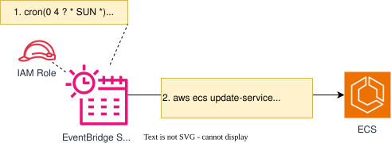

## 目的

`AWS Fargate`は、AWSによって管理されているホストのため、１〜2ヶ月ごとなど定期的にパッチ適用（リタイヤメント）が発生します。  
パッチ適用は、一定の（ユーザ側の任意のタイミングで実施できる）猶予期間後、AWSのタイミングで強制的に行われるため、営業時間中に適用された場合は、サービス影響が発生する可能性があります。  
従って、`Fargate`のリタイヤメントによるサービス影響が発生しないように営業日以外のタイミングなどで、新しいタスクを実行する仕組みを提供します。 

>メールの件名例  
[Notification] Upcoming routine retirement of your AWS Elastic Container Service tasks running on AWS Fargate beginning ~~~

{: .warning}  
本テンプレートを利用すると、毎週必ず`ECS タスク`の入れ替えが発生します。  

## 概念図
 
  
  
 

## 提供テンプレート(CloudFormation)

| ファイル名 | 用途 | 保存先 (S3 URL) | 
| --- | --- | --- |
| [ecs-fargate-retirement-handler-template.yml](https://ap-northeast-1.console.aws.amazon.com/cloudformation/home?region=ap-northeast-1#/stacks/quickcreate?templateURL=https://dgcp-container-guide-311141522354.s3.ap-northeast-1.amazonaws.com/deploy/infrastructure/files/template/ecs-fargate-retirement-handler-template.yml){: target="_blank"} | Fargateリタイヤメント対応自動化の構築 | `https://dgcp-container-guide-311141522354.s3.ap-northeast-1.amazonaws.com/deploy/infrastructure/files/template/ecs-fargate-retirement-handler-template.yml` |

{: .note}  
DGCPのAWSへログインした状態でymlリンクを開き、以下パラメータを入力/変更してください。  

## 入力パラメータ

| パラメータ名 | 必須項目 | デフォルト値 | 説明 | 
| --- | --- | --- | --- |
| OperationTime | - | `cron(0 4 ? * SUN *)` | リタイヤメントの適用時間を入力 デフォルトは、`日曜 午前4時`に適用 |
| TimeZone | - | `Asia/Tokyo` | タイムゾーンを入力 |
| ECSClusterName | ○ | - | 対象のECSクラスター名を入力 |
| ECSServiceName | ○ | - | 対象のECSサービス名を入力 |

## 出力リソース

| リソース種別 | 出力例 |
| --- | --- |
| EventBridge ScheduleGroup | RIHandlerGrp-`ECSサービス名` |
| EventBridge Schedule | RIHandler-`ECSサービス名` | 
| IAM Role | `スタック名`-EventBridgeSchedulerRole-`スタックID` |

※RI=Retirement