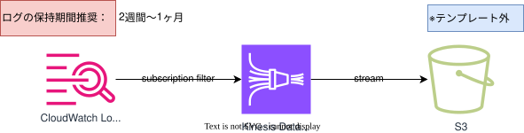

## 目的

`電通Security Policy（システムチェックシート等）`では、`13ヶ月`のログ保管を求められていますが、  
`CloudWatch Logs`へ長期的にログ保管するのはコストパフォーマンス的に非推奨となります。  
従ってコスト最適化を図るために、`CloudWatch Logs Subscription Filter`、`Data Firehose`、`S3`を利用したログローテーションの仕組みを提供します。  

{: .note}  
ECSなどのコンテナの場合は、本仕組みではなく、[ログルータの利用](/deploy/fluentbit/)を検討してください。  
ログローテーションの仕組みでは、Logs-S3間における[Firehoseの転送料金](https://aws.amazon.com/jp/firehose/pricing/){: target="_blank"}が発生するため、コンテナから直接S3へ出力する方がコスト面で優れています。  

{: .tip}  
`CloudWatch Logs`の機能の1つに、`create-export-task（S3へのログエクスポート）`があります。  
但し、AWSアカウント上で同時に1つのタスクしか（並列処理が）実行できないことからテンプレートとして利用及び提供していません。  
緊急時に一括でファイル取得するなどの用途で利用を推奨します。  
詳細は、[Amazon S3 へのログデータのエクスポート](https://docs.aws.amazon.com/ja_jp/AmazonCloudWatch/latest/logs/S3Export.html){: target="_blank"}を参照してください。　　

## 概要図 
 
  
  
 

## 提供テンプレート(CloudFormation)

{: .note}  
S3の構築については、[アーカイブ用S3](./archive-s3.html)を参照してください

| ファイル名 | 用途 | 保存先 (S3 URL) | 
| --- | --- | --- |
| [log-rotation-template.yml](https://ap-northeast-1.console.aws.amazon.com/cloudformation/home?region=ap-northeast-1#/stacks/quickcreate?templateURL=https://dgcp-container-guide-311141522354.s3.ap-northeast-1.amazonaws.com/deploy/infrastructure/files/template/log-rotation-template.yml){: target="_blank"} | ログローテーションの構築 | `https://dgcp-container-guide-311141522354.s3.ap-northeast-1.amazonaws.com/deploy/infrastructure/files/template/log-rotation-template.yml` |

{: .note}  
DGCPのAWSへログインした状態でymlリンクを開き、以下パラメータを入力/変更してください。  

## 入力パラメータ
### Project Configuration

| パラメータ名 | 必須項目 | デフォルト値 | 説明 | 
| --- | --- | --- | --- |
| SystemId | 〇 | - | 実行するシステム識別子を入力 |  
| EnvType | 〇 | - | [環境種別](/faq/dgcp_environment.html){:target="_blank"}を選択 |  
| BillingID | 〇 | - | 請求IDを入力 |  

### Data Firehose Configuration

| パラメータ名 | 必須項目 | デフォルト値 | 説明 | 
| --- | --- | --- | --- |
| LogGroupName | 〇 | - | 格納元CloudWatch Logsのロググループ名を入力 | 
| S3BucketName |  〇 | - | 送付先S3バケット名を入力 |
| SizeInMBs | - | `5` | 宛先に配信する前に受信データに使用するバッファのサイズ（MB）を入力 |
| IntervalInSeconds | - | `300` | 受信データを宛先に配信する前にバッファリングする時間の長さ（秒）を入力 |

### KMS Configuration

| パラメータ名 | 必須項目 | デフォルト | 説明 |  
| --- | --- | --- | --- |
| KMSKeyArn | - | - | KMSKeyのARNを入力 |  

{: .tip}  
・DGCPのKMSキー`<AWSアカウントID>-kms`  
・各担当者でKMSキー`要作成`  
どちらかのKMSキーで暗号化してください。  

{: .important}  
KMS暗号化は、情報区分「`極秘・取り扱い厳重注意`」時のみ必須となります。  

## 出力リソース

| リソース種別 | 出力例 | 備考 | 
| --- | --- | --- |
| SubscriptionFilter | log-rotation-filter | |
| IAMロール | `スタック名`-SubscriptionFilterRole-`スタックID` |  |
| DeliveryStream | logs-`ロググループ名`-delstream | ロググループ名に含まれる`/`は`_`に置換されます |
| IAMロール | `スタック名`-DeliveryRole-`スタックID` |  |

{: .important}  
本テンプレートの実行後、適用したロググループの保持期間は、`２週間〜1ヶ月`を推奨します。  
保持期間が`失効しない`になっていないか確認してください。