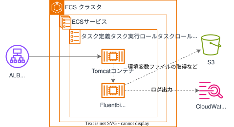

## 目的
業務系個別環境基盤では、アプリ側のアプリケーションアーキテクチャに基づき、インフラ構築を行うことを前提としたプラットフォームとなっています。  
しかし一方で、従来インフラ構築をDGCPへお任せ頂いていたため、難しい部分もある認識です。  
従って、担当者はパラメータ入力のみ実施すればインフラを構築できる、標準的なインフラセットとしてMPAのWebアプリケーション（DBを除く）のテンプレートを提供します。

{: .note}  
・DBは、 [データベース利用ガイドライン](https://dgcp-db-guideline.dentsu.jp/){:target="_blank"}  
を参照してください。 

## 概要図
 
  

 

## 提供テンプレート(CloudFormation)

| ファイル名 | 用途 | 保存先 (S3 URL) | 
| --- | --- | --- |
| [tom-infra-template.yml](https://ap-northeast-1.console.aws.amazon.com/cloudformation/home?region=ap-northeast-1#/stacks/quickcreate?templateURL=https://dgcp-container-guide-311141522354.s3.ap-northeast-1.amazonaws.com/deploy/infrastructure/files/template/tom-infra-template.yml){: target="_blank"} | Tomcat(MPA用)テンプレート | `https://dgcp-container-guide-311141522354.s3.ap-northeast-1.amazonaws.com/deploy/infrastructure/files/template/tom-infra-template.yml` |

{: .note}  
テンプレートの詳細な内部実装を確認したい場合は、[リンク(SNET限)](https://dgcp-container-guide.dentsu.jp/deploy/infrastructure/files/detail/tomcat-template.htm){:target="_blank"} を参照してください。

{: .note}  
DGCPのAWSへログインした状態でymlリンクを開き、以下パラメータを入力/変更してください。  

## 入力パラメータ
### Project Configuration

| パラメータ名 | 必須項目 | デフォルト | 説明 |  
| --- | --- | --- | --- |
| SystemId | 〇 | - | 実行するシステム識別子を入力 |  
| EnvType | 〇 | - | [環境種別](/faq/dgcp_environment.html){:target="_blank"}を選択 |  
| BillingID | 〇 | - | 請求IDを入力 | 
| SecurityGroupIds | 〇 | - | [セキュリティグループ](/flow/#req3){:target="_blank"}を選択 |   

### ELB Configuration

| パラメータ名 | 必須項目 | デフォルト | 説明 |  
| --- | --- | --- | --- |
| ACM | 〇 | - | [ACM証明書](https://ap-northeast-1.console.aws.amazon.com/acm/home?region=ap-northeast-1#/certificates/list){:target="_blank"}のARNを入力  |  
| TomHealthCheckPath | - | /mngcheck | ヘルスチェックパスを入力 |  
| Stickiness | - | true | Sticky Sessionの利用有無を入力 |  
| IdleTimeoutSeconds | - | 360 | アイドル接続状態解除までの時間（秒）を入力 |  

{: .tip}  
ACM証明書は、事前に[コンテナ利用フロー > 非本番環境の構築 > ACM証明書の発行](/flow/#req4){:target="_blank"}を参照し、ACM証明書の発行とDNS申請を行ってください。  
DGCP初期構築として払い出される構築検証用のACM`<AWSアカウントエイリアス名>.dentsu.co.jp`を利用することも出来ます。  

### ECS Configuration

| パラメータ名 | 必須項目 | デフォルト | 説明 |  
| --- | --- | --- | --- |  
| ClusterNameSuffix | - | apl01 | ECSクラスター名のSuffixを入力 |  
| ContainerInsights | - | enabled | ContainerInsightsの`enhance``enabled``disabled`を選択 メトリクス監視するためには`enable`以上が必要 |  
| TomServiceNameSuffix | - | tom01 | Tomcatのサービス名のSuffixを入力 |  
| TomContainerPort | - | 31100 | Tomcatの待ち受けポートを入力 |  
| TomECSTaskCPUUnit | - | 2048 | タスクのCPUユニット数を入力 |  
| TomECSTaskMemory | - | 4096 | タスクのメモリ容量を入力 |  
| TomDesiredCount | - | 1 | 維持したいタスク数を入力 |  

### S3 Configuration

| パラメータ名 | 必須項目 | デフォルト | 説明 |  
| --- | --- | --- | --- |
| BucketNameSuffix | - | fsv-01 | S3バケットのSuffixを入力 |  

{: .warning}  
既存環境に同じ名前のS3がある場合、サフィックスを変更してください。

### Logs Configuration

| パラメータ名 | 必須項目 | デフォルト | 説明 |  
| --- | --- | --- | --- |
| LogsRetentionInDays | - | 30 | ログの保持期間を入力 |  

### KMS Configuration

| パラメータ名 | 必須項目 | デフォルト | 説明 |  
| --- | --- | --- | --- |
| KMSKeyArn | - | - | KMSKeyのARNを入力 |  

{: .tip}  
・DGCPのKMSキー`<AWSアカウントID>-kms`  
・各担当者でKMSキー`要作成`  
どちらかのKMSキーで暗号化してください。  

{: .important}  
KMS暗号化は、情報区分「`極秘・取り扱い厳重注意`」時のみ必須となります。  

## 出力リソース

| リソースの種類 | 出力例 |
| --- | --- |
| ALB | alb-t-ccntnt-int-tom01 |  
| Target Group | alb-tg-t-ccntnt-int-tom01 |  
| ECSクラスタ | ecs-cluster-t-ccntnt-apl01 |  
| ECSサービス | ecs-service-t-ccntnt-tom01 |  
| タスク定義 | ecs-task-t-ccntnt-tom01 |  
| タスク実行ロール | rol-t-ccntnt-taskexecute |  
| タスクロール | rol-t-ccntnt-task-tom01 |  
| タスクロールポリシー | pol-t-ccntnt-task-tom01 |  
| S3 | s3-t-ccntnt-fsv-01 |  
| CloudWatchLogs | /ecs/ecs-task-t-ccntnt-tom01 |  
  
{: .note}  
出力例は、下記の入力パラメータを設定した場合に出力される値です。
  
| パラメータ名 | 値 |  
| --- | --- |
| SystemId | ccntnt |  
| EnvType | t |

## その他必要な作業について

1. アプリのコンテナイメージを作成する場合　→　[ベースイメージでのイメージビルド](/docker/build.html){:target="_blank"}  
1. ECR（Dockerイメージ格納用リポジトリ）を作成する場合　→　[手動デプロイガイド > ECRの構築手順](/deploy/manual/ecr-construction.html){:target="_blank"} or [インフラテンプレート > ECRテンプレート](/deploy/infrastructure/ecr.html){:target="_blank"}  
1. 手動デプロイを行う場合　→　[手動デプロイガイド > ECSへのデプロイ](/deploy/manual/deploy-browser.html){:target="_blank"}  
1. CICDを構成する場合　→　[CICDテンプレート利用ガイド](/deploy/cicd/){:target="_blank"}  
1. S3にもログ出力する場合　→　[Fluent Bit（DGCP標準）利用ガイド>設定ファイルと出力](/deploy/fluentbit/configuration.html){:target="_blank"}  
  
を参照してください。