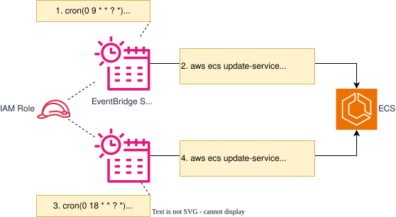

## 目的

`非本番環境`などで`24h365d`で稼働し続ける必要がないケースが多く存在します。  
従って費用削減に寄与するため、定期的に`ECSサービスのタスク数`を増減できる仕組みを提供します。  

{: .note}  
本テンプレートは、`タスク数`を`2（起動）`、`0（停止）`と増減するようにしていますが、  
カスタマイズすることでピーク時間帯は`3`、それ以外は、`1`とスケールイン・アウトの用途として利用することもできます。

## 概要図 
 
  
  
 

## 提供テンプレート(CloudFormation)

| ファイル名 | 用途 | 保存先 (S3 URL) | 
| --- | --- | --- | --- |
| [ecs-service-startstop-schduler-template.yml](https://ap-northeast-1.console.aws.amazon.com/cloudformation/home?region=ap-northeast-1#/stacks/quickcreate?templateURL=https://dgcp-container-guide-311141522354.s3.ap-northeast-1.amazonaws.com/deploy/infrastructure/files/template/ecs-service-startstop-schduler-template.yml){: target="_blank"} | ECSサービス定期起動停止の構築 | `https://dgcp-container-guide-311141522354.s3.ap-northeast-1.amazonaws.com/deploy/infrastructure/files/template/ecs-service-startstop-schduler-template.yml` |

{: .note}  
DGCPのAWSへログインした状態でymlリンクを開き、以下パラメータを入力/変更してください。  

## 入力パラメータ

| パラメータ名 | 必須項目 | デフォルト値 | 説明 | 
| --- | --- | --- | --- |
| StartServiceTime | - | `cron(0 9 * * ? *)` | Cron式を入力 デフォルトは、`毎日 9時`に起動 |
| StopServiceTime | - | `cron(0 18 * * ? *)` | Cron式を入力 デフォルトは、`毎日 18時`に停止 |
| TimeZone | - | `Asia/Tokyo` | タイムゾーンを入力 |
| DesiredCount | - | `2` | ECSサービスの維持するタスク数を入力 |
| ECSClusterName | ○ | - | 対象のECSクラスター名を入力 |
| ECSServiceName | ○ | - | 対象のECSサービス名を入力 |

## 出力リソース

| リソース種別 | 出力例 |
| --- | --- |
| EventBridge ScheduleGroup | ScheGrp-StartStop-`ECSサービス名` |
| EventBridge Schedule | Sche-Start-`ECSサービス名` |
| EventBridge Schedule | Sche-Stop-`ECSサービス名` |
| IAM Role | `スタック名`-EventBridgeSchedulerRole-`スタックID` |