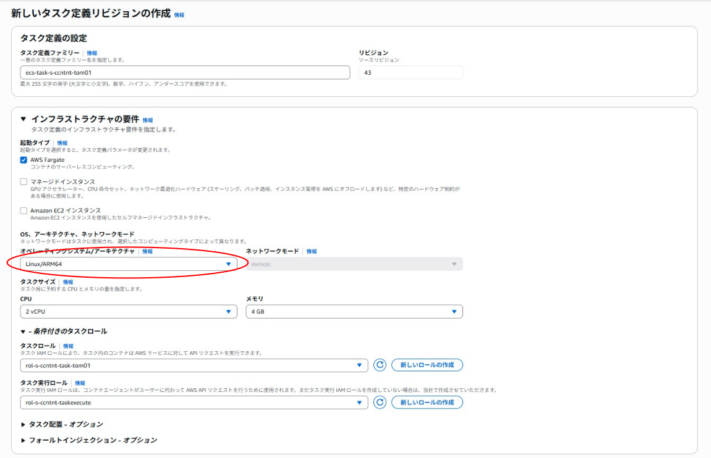

<details open markdown="block">
  <summary>
    目次
  </summary>
  {: .text-delta }

  - TOC
  {:toc}
</details>

# ARM64対応イメージを使用する
ここでは、ARM64対応イメージの使い方をコマンドライン+AWSコンソールとGitHub Actionsの両方で説明します。

## ARM64対応イメージ
現在対応しているARM64対応イメージは下記の通りです。

| ベースイメージ | 対応バージョン | 備考 |  
| --- | --- | --- |  
| amazonlinux2023以降 | 2023.12.20260918.0以降 | amazonlinux2は未対応 |  
| java17以降 | 17.0.20.12.1-1.0-2023.12.20260918.0以降 | java8は未対応|  
| tomcat10以降 | 10.1.60-jdk17.0.20.12.1-1.1-2023.12.20260918.0以降 | tomcat8は未対応 |  
| fluentbit3以降 | 	3.5.0-1.1以降 | 2系は未対応 |  


## 1.コマンドラインとAWSコンソールによる使用方法


### 1-1. 公開用ECRからARM64イメージののPullする  

[公開用ECRにログイン](https://dgcp-ope.backlog.com/wiki/DGCP_APP_CONTAINER_RECEPT/%E3%82%B3%E3%83%B3%E3%83%86%E3%83%8A%E3%83%81%E3%83%BC%E3%83%A0%E7%AE%A1%E7%90%86%E3%81%AE%E3%83%99%E3%83%BC%E3%82%B9%E3%82%A4%E3%83%A1%E3%83%BC%E3%82%B8#loom-header-7){:target="_blank"}し
ARM64イメージを取得する。

```powershell
# docker pull --platform linux/arm64 [公開用ECRのURI]
docker pull --platform linux/arm64 533994313413.dkr.ecr.ap-northeast-1.amazonaws.com/ecr-pub-p-ccntnr-tomcat:10-jdk17
```

{: .tip}  
**引数**に、[--platform linux/arm64]を指定しPullする。  
-- platformの引数はDockerDesktopのバージョン4.19.0以降でサポートされています。  

<br>

### 1-2．アプリケーションのARM64イメージをBuildする  

以下、コマンドを実行します。

```powershell
# ARM64イメージをBUID
# docker build  --provenance=false --platform linux/arm64  -t PUSHするECRのURI .
docker build  --provenance=false --platform linux/arm64  -t 908027375710.dkr.ecr.ap-northeast-1.amazonaws.com/ecr-pri-s-ccntnt-tom:1.0.0 .
```  
{: .tip}  
**引数**に、[--platform linux/arm64]を指定しビルドする。  
<br>


### 1-3．BuildしたARM64イメージをPushする  

[アプリのECRにログイン](../manual/deploy-browser.html#1-2イメージをpushする){:target="_blank"}し
ビルドしたARM64イメージをPushする。


### 1-4．タスク定義を更新する。  
　1. コンソールを開き「新しいリビジョンの作成」を押下します。 

　2. オペレーションシステム/アーキテクチャを「Linux/Arm64」へ変更します。 
      

### 1-5．サービスを更新する。  

　1. タスク定義のリビジョンを変更し、サービスを更新します。

<br>

## 2.GitHub Actionsによる使用方法

### 2-1.  ymlファイルを更新する。 
```yml1
#ARM64のエミュレータを使用するために下記を追加する。
      - name: Set up QEMU
        uses: docker/setup-qemu-action@v4
```  


```yml2
#Buildx Builderをセットアップするために下記を追加する。
      - name: Set up Docker Buildx
        uses: docker/setup-buildx-action@v4
```  

```yml3
# platforms: linux/arm64を追加する。
      - name: build and push docker image to ecr
        id: build-image
        uses: docker/build-push-action@v6
        env:
          REGISTRY: ${{ steps.login-ecr.outputs.registry }}
          IMAGE_TAG: ${{ github.sha }}
        with:
          context: ${{ github.workspace }}
          file: ${{env.MODULE}}/Dockerfile
          platforms: linux/arm64
          tags: ${{ env.REGISTRY }}/${{ env.ECR_REPOSITORY }}:${{ env.IMAGE_TAG }}
          push: true
```  
### 2-2.  タスク定義を更新する。

```task1
# task定義に下記を追加する。
  "runtimePlatform": {
    "cpuArchitecture": "ARM64",
    "operatingSystemFamily": "LINUX"
  }
```  
[デベロッパーガイド参照](https://docs.aws.amazon.com/ja_jp/AmazonECS/latest/developerguide/ecs-arm-specifying.html){:target="_blank"}


