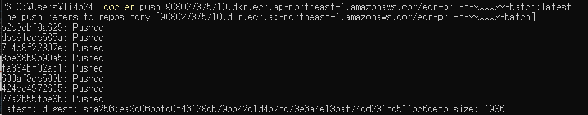
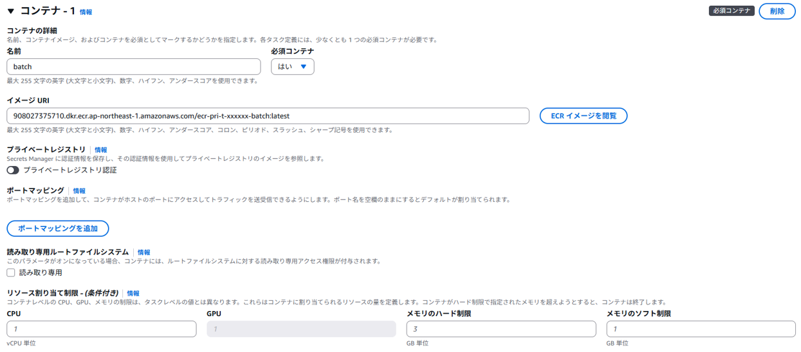
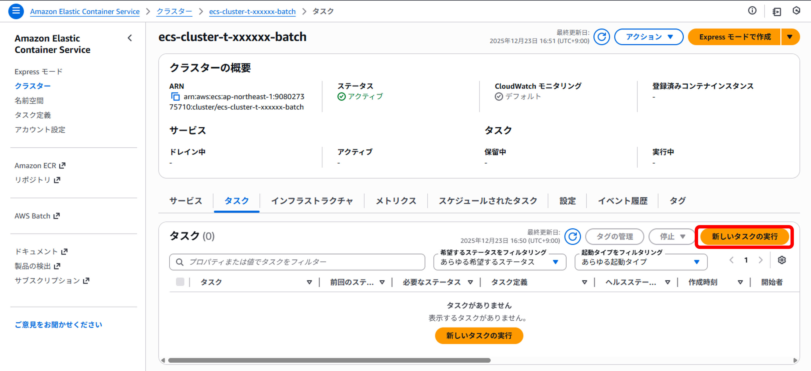
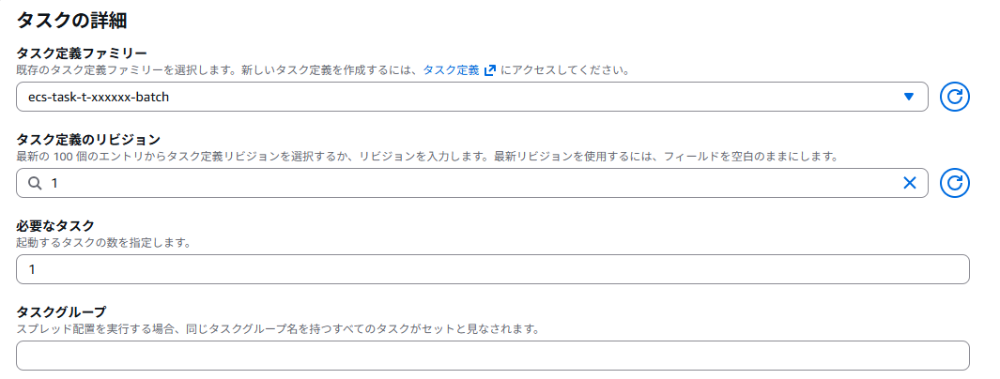
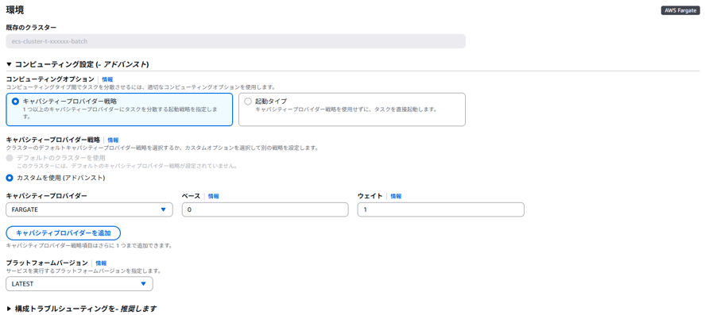
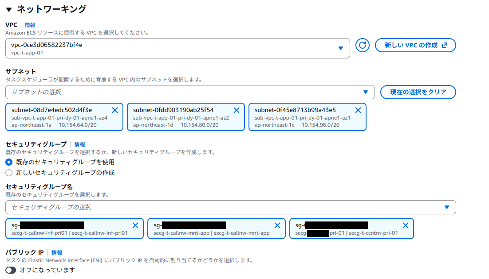
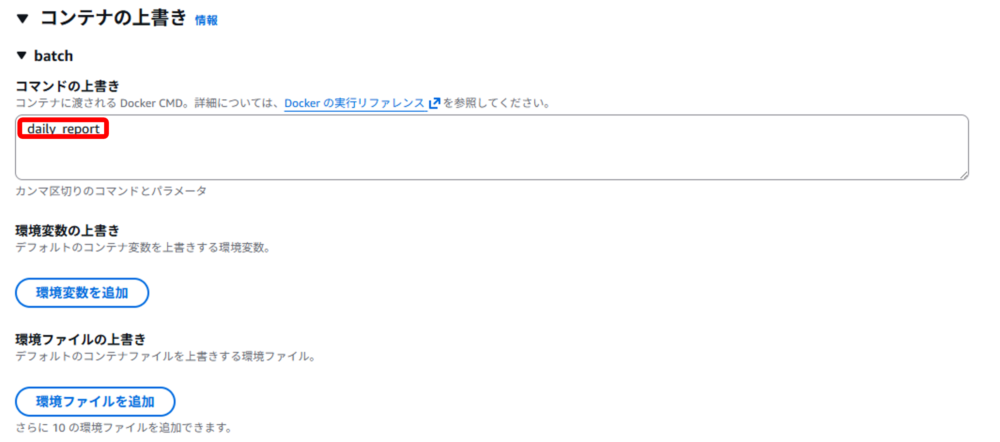
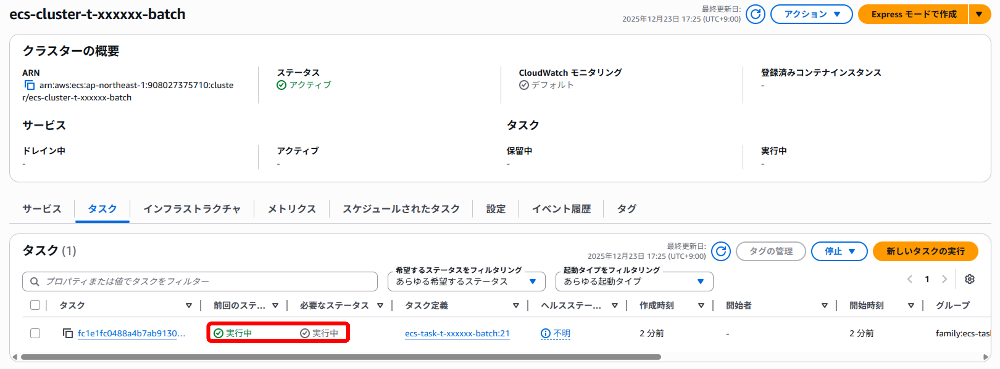
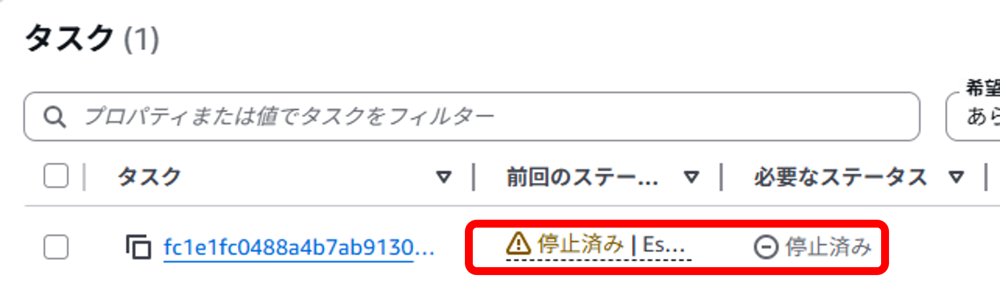
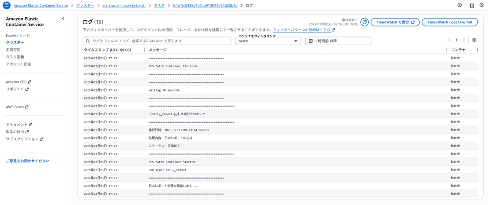

{: .tip}  
本手順をパラメータ入力だけで構築できる[テンプレートを公開](/deploy/infrastructure/batch.html)しています。

  

    目次
  

  {: .text-delta }

  - TOC
  {:toc}

---

{: .note}  
**本文中で作成するAWSリソース名に関して**  
`t/p` は `非本番/本番` 、`xxxxxx`は`システム識別子`を表しています。  
各アプリ側で必要な値へ置き換えてください。  
本手順は、**非本番環境**での構築としています。　　

{: .note}  
本手順は[バッチコンテナの作成内のサンプル](/docker/official/batchContainer.html#サンプルについて){:target="_blank"}を用いて説明しています。  
上記ページを参照の上、各アプリ要件に応じて処理を変更してください。  

## 1. バッチコンテナ用ECRの作成  
[ECRの構築手順](../manual/ecr-construction.html){:target="_blank"}を参照ください。  
  

## 2. ECRへプッシュ  
1 で作成したECRにイメージをプッシュします。  
[ECSへのデプロイ（管理コンソール）> 1.イメージのPush](../manual/deploy-browser.html#1イメージのpush){:target="_blank"}を参照し実行してください。  
成功すると以下のような出力になります。  
タグ名などは各自調整してください。  
  

{: .warning}  
**本番運用の際は、latestタグを使用しないでください**  
この手順書でlatestタグを用いているのは、`手順提示のため`です。  
アプリチームで利用する際は、`バージョン管理（構成管理）`を行ってください。  
latestタグを使用すると、ECSタスク定義上で「どの時点のアプリケーションコードがデプロイされているか」が特定できなくなります。  
イメージタグについては、[デプロイ戦略 > ECR・ECSのデプロイ戦略方式一覧 > Tip](../strategy/index.html#ecrecsのデプロイ戦略方式一覧){:target="_blank"}を参照してください  

## 3. タスク定義の作成  
基本的な操作/設定は[ECS環境の構築手順 > 2.タスク定義の作成](../manual/ecs-construction.html#2タスク定義の作成){:target="_blank"}を参照してください。  
バッチコンテナに必要な設定のみピックアップして記載します。  
### タスク定義の設定/インフラストラクチャの要件  

| 設定項目 | 設定値 | 備考 |  
| --- | --- | --- |  
| タスク定義ファミリー名 | ecs-task-t-xxxxxx-batch |  |  
| CPU/メモリ | .5vCPU/1GB | バッチ処理の要件により変更ください |  
| タスクロール | 《任意》 | 処理で必要なポリシーがあれば追加する |  
| タスク実行ロール | rol-t-xxxxxx-taskexecute | アプリと同じタスク実行ロールを指定 |  

{: .note}  
タスクロールと、タスク実行ロールについては、[タスクロールとタスク実行ロールの違い](../../container/role/){:target="_blank"}について参照してください。  

### コンテナ  
* **バッチコンテナ**  
  

    | 設定項目 | 設定値 | 備考 |  
    | --- | --- | --- |
    | 名前 | 《任意》 | - |  
    | イメージURI | 908027375710.dkr.ecr.ap-northeast-1.amazonaws.com/ecr-pri-t-xxxxxx-batch:latest | 2でPushしたイメージのURI |  

## 4. クラスターの作成  
クラスターの作成については、[ECS環境の構築手順 > 3.ECS Clusterの作成](../manual/ecs-construction#3ecs-clusterの作成){:target="_blank"}を参照してください。  

## 5. ECSバッチの手動実行  

### クラスタータスクの作成  
`ECS` > `クラスター` > `4.で作成したクラスター` > `タスク` > `新しいタスクの実行` を押下  
  

* **タスクの詳細**    
      

    | 設定項目 | 設定値 | 備考 |  
    | --- | --- | --- |
    | タスク定義ファミリー | ecs-task-t-xxxxxx-batch | 3.で作成したタスク定義を指定 |  
    | タスク定義のリビジョン | 1(最新) | 最新のリビジョンを指定 |  

* **環境**  
      
    デフォルト設定  

* **ネットワーキング**  
      

    《サブネット》

    | アベイラビリティーゾーン | サブネット | 備考 |    
    | --- | --- | --- |  
    | ap-northeast-1a | sub-vpc-t-app-01-pri-dy-01-apne1-az4 | DGCPのネットワークを利用するため |    
    | ap-northeast-1c | sub-vpc-t-app-01-pri-dy-01-apne1-az1 | DGCPのネットワークを利用するため |    
    | ap-northeast-1d | sub-vpc-t-app-01-pri-dy-01-apne1-az2 | DGCPのネットワークを利用するため |    

    《セキュリティグループ》
    - `secg-t-<システム識別子>-pri-01`
    - `secg-t-callnw-mnt-app`
    - `secg-t-callnw-inf-pri01`

* **コンテナの上書き**  
      

    コマンドの上書きの部分に引数で渡していた物を入力。  
    （例：daily_report、monthly_reportなど）  
    ※エラーの挙動を試したい場合は空での実行や登録していない引数を渡し実行してください。  

    {: .note}  
    本手順は[バッチコンテナの作成内のサンプル > entrypoint.sh](/docker/official/batchContainer#entrypointsh){:target="_blank"}を用いて説明しています。  
    コンテナの上書き（オーバーライド）についても各アプリ要件に応じて変更してください。  

一通り入力が完了したら、`作成`を押下します  

### 実行の確認  
作成を押下後`実行`されていることを確認します。  
  

その後、バッチ処理の実行が終わり、`停止済み`になっていることを確認します。  
  

`該当タスク` > `ログ` を確認します  
正常な出力がされていれば、手動実行での動作確認は終了です。  
  

