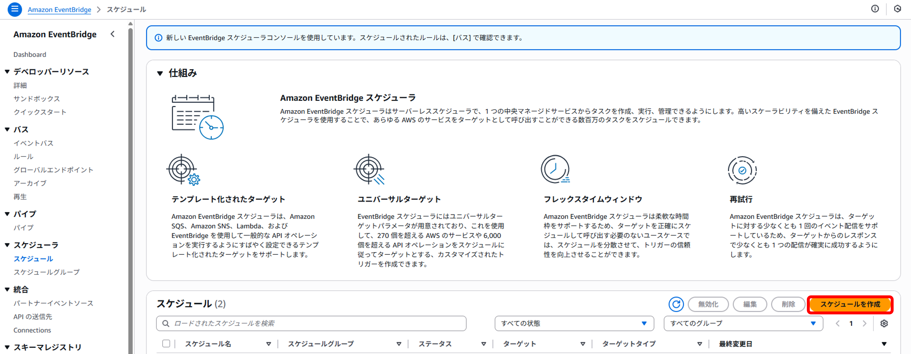
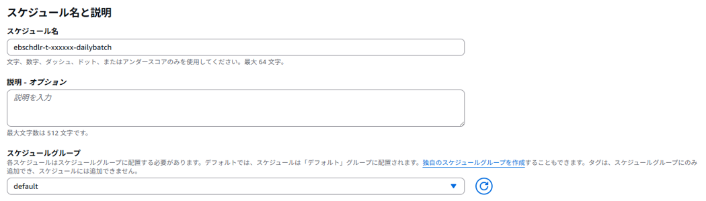
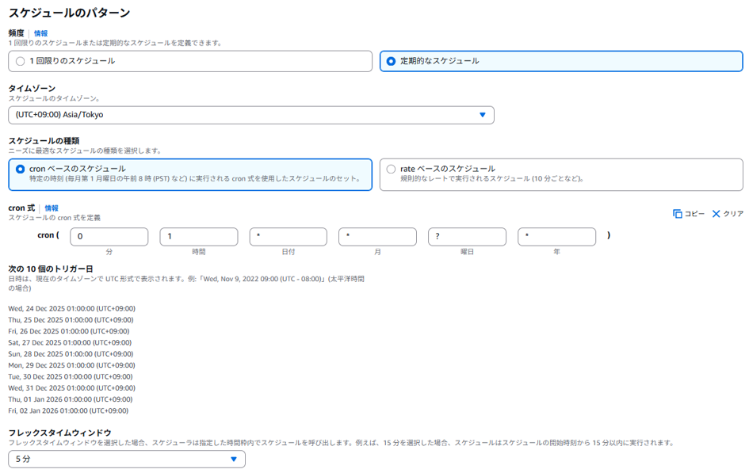
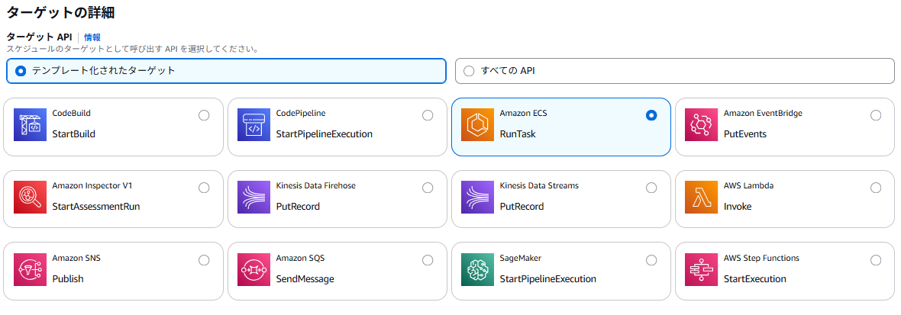
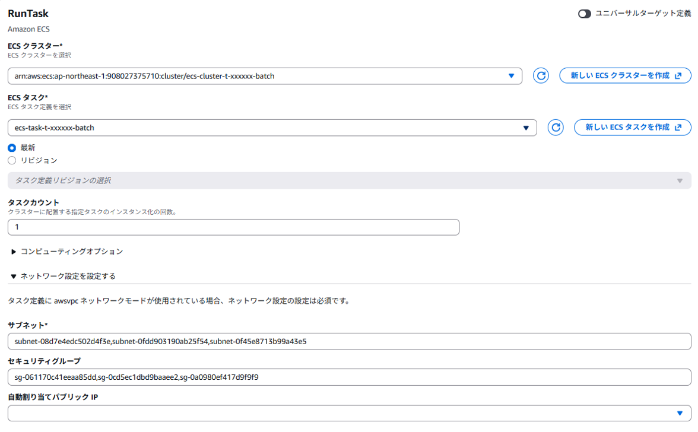
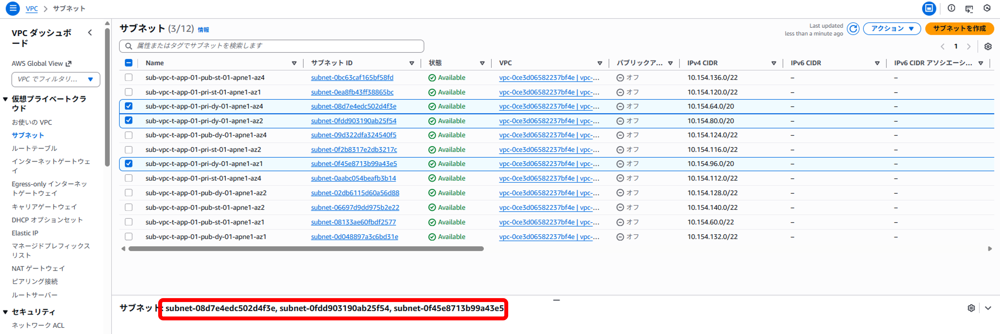
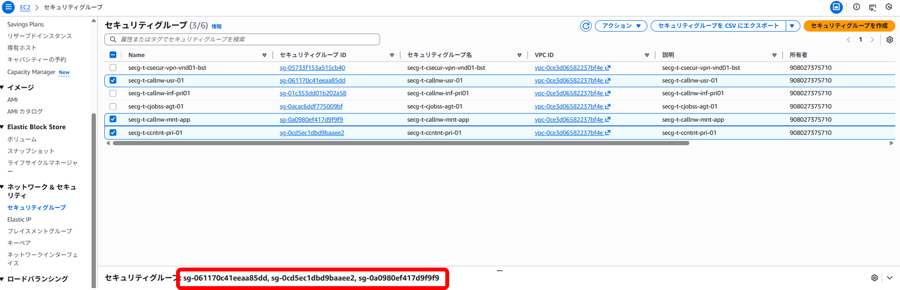
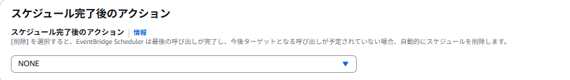
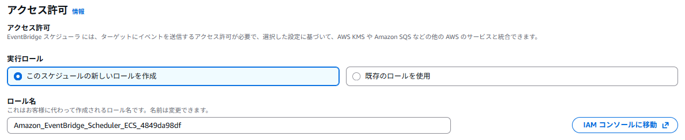

<details open markdown="block">
  <summary>
    目次
  </summary>
  {: .text-delta }

  - TOC
  {:toc}
</details>

---  

# スケジューリング   

{: .note}  
**本文中で作成するAWSリソース名に関して**  
`t/p` は `非本番/本番` 、`xxxxxx`は`システム識別子`を表しています。  
各アプリ側で必要な値へ置き換えてください。  
本手順は、**非本番環境**での構築としています。　　

{: .note}  
本手順は[バッチコンテナの作成内のサンプル](/docker/official/batchContainer#サンプルについて){:target="_blank"}を用いて説明しています。  
上記ページを参照の上、各アプリ要件に応じて処理を変更してください。  

## 1. EventBridgeSchedulerの設定  
`Amazon EventBridge` > `スケジューラ` > `スケジュール` > `スケジュールを作成` を押下します。  
  

### スケジュールの作成  
* **スケジュールの詳細の指定**  
      

    | 設定項目 | 設定値 | 備考 |  
    | --- | --- | --- |
    | スケジュール名 | ebschdlr-t-xxxxxx-dailybatch | - |  
    | スケジュールグループ | default | - |  

* **スケジュールの指定**  
    画像は日次バッチの指定例です。(毎日0:00に実行)

      

    | 設定項目 | 設定値 | 備考 |  
    | --- | --- | --- |
    | 頻度 | 定期的なスケジュール | - |  
    | タイムゾーン | Asia/Tokyo | - |  
    | スケジュールの種類 | cronベースのスケジュール | - |  
    | フレックスタイムウィンドウ | 任意時間 | - |  

    cronの指定方法については「[cron 式と rate 式を使用して Amazon EventBridge でルールをスケジュールする](https://docs.aws.amazon.com/ja_jp/eventbridge/latest/userguide/eb-scheduled-rule-pattern.html){:target="_blank"}」を参照し設定してください。  

`次へ`を押下します  

* **ターゲットの詳細**  
      

    | 設定項目 | 設定値 | 備考 |  
    | --- | --- | --- |
    | ターゲットAPI | テンプレート化されたターゲット | - |  
    | ターゲットAPI | Amazon ECS RunTask | - |  

* **RunTask**  

      

    | 設定項目 | 設定値 | 備考 |  
    | --- | --- | --- |
    | ECS クラスター | [ECSバッチの作成 > 4.クラスターの作成](/deploy/manual/batchContainerAWS.html#4-クラスターの作成){:target="_blank"}で作成したクラスターを指定 | - |  
    | ECS タスク | [ECSバッチの作成 > 3.タスク定義の作成](/deploy/manual/batchContainerAWS.html#3-タスク定義の作成){:target="_blank"}で作成したタスク定義を指定 | - |  
    | サブネット | [ECSバッチの作成 > 5. ECSバッチの手動実行 > クラスタータスクの作成 > ネットワーキング](/deploy/manual/batchContainerAWS.html#クラスタータスクの作成){:target="_blank"}で指定したサブネットの`サブネットID`を指定 | 以下、表を参照 |  
    | セキュリティグループ | [ECSバッチの作成 > 5. ECSバッチの手動実行 > クラスタータスクの作成 > ネットワーキング](/deploy/manual/batchContainerAWS.html#クラスタータスクの作成){:target="_blank"}で指定したサブネットの`セキュリティグループID`を指定 | 以下、表を参照 |  

    《サブネット》

    | アベイラビリティーゾーン | サブネット | 備考 |    
    | --- | --- | --- |  
    | ap-northeast-1a | sub-vpc-t-app-01-pri-dy-01-apne1-az4 | DGCPのネットワークを利用するため |    
    | ap-northeast-1c | sub-vpc-t-app-01-pri-dy-01-apne1-az1 | DGCPのネットワークを利用するため |    
    | ap-northeast-1d | sub-vpc-t-app-01-pri-dy-01-apne1-az2 | DGCPのネットワークを利用するため |    

    《セキュリティグループ》
    - `secg-t-<システム識別子>-pri-01`
    - `secg-t-callnw-mnt-app`
    - `secg-t-callnw-inf-pri01`

    <br>

    ・ **サブネットIDの取得方法**  
     `VPC` > `サブネット` から`該当サブネット`にチェック。下部の「サブネット：subnet-~」をコピペしてください。  
     **※コピペした場合、先頭と「,」の後に半角スペースが入っているため削除してください。**  
       

    ・ **セキュリティグループIDの取得方法**  
     `EC2` > `セキュリティグループ` から`該当セキュリティグループ`にチェック。下部の「セキュリティグループ：sg-~」をコピペしてください。  
     **※コピペした場合、先頭と「,」の後に半角スペースが入っているため削除してください。**  
       

* **オーバーライド**  
オーバーライド内に、以下のスクリプトを記入。  

    ```json
    {
    "containerOverrides": [
        {
        "name": "batch",
        "command": [
            "daily_report"
        ]
        }
    ]
    }
    ```

    その他にオーバーライドできるものについては、公式ドキュメント「[ContainerOverride](https://docs.aws.amazon.com/AmazonECS/latest/APIReference/API_ContainerOverride.html){:target="_blank"}」を参照してください。

* **スケジュール完了後のアクション**  
      

    | 設定項目 | 設定値 | 備考 |  
    | --- | --- | --- |
    | スケジュール完了後のアクション | DELETE/NONE | 実行後にスケジュールを削除するか選択 |  

* **アクセス許可**  
      

    | 設定項目 | 設定値 | 備考 |  
    | --- | --- | --- |
    | 実行ロール | このスケジュールの新しいロールを作成 | RunTaskするのに必要なポリシーは含まれています |  

「スケジュールの確認と保存」に遷移し、確認したら`スケジュールを保存`を押下して作成を完了させてください。  

## 2. EventBridgeSchedulerからの実行  
1.で設定した実行時間に自動的に実行されます。  
深夜にバッチを動かした場合、手動実行時のようにコンソール上でログの確認ができない可能性があります。（コンソール上のログは1時間で消えてしまう仕様です）  
[FAQ > AWS関連（運用関連） > ECSタスクの停止理由（StoppedReason）を保管したい ※外部サイト](../../faq/){:target="_blank"}を参照してください。  
うまく動作していない、ログが出ていない場合はCloudTrailを確認しエラーが出ていないか調査してください。  
