<details open markdown="block">
  <summary>
    目次
  </summary>
  {: .text-delta }

  - TOC
  {:toc}
</details>

---

<ins>補足資料</ins>
- [タスク定義頻出パラメータ](/deploy/taskdef/)
- [Systems Manager(SSM) Parameter Storeの利用](/deploy/parameterstore/)

---

{: .note}  
**本文中で作成するAWSリソース名に関して**  
・`084563037095`は `AWSアカウントID`  
・`t/p` は `非本番/本番`  
・`iappoc`は`システム識別子` を表しています。    
各アプリ側で必要な値へ置き換えてください。  

## 概念図
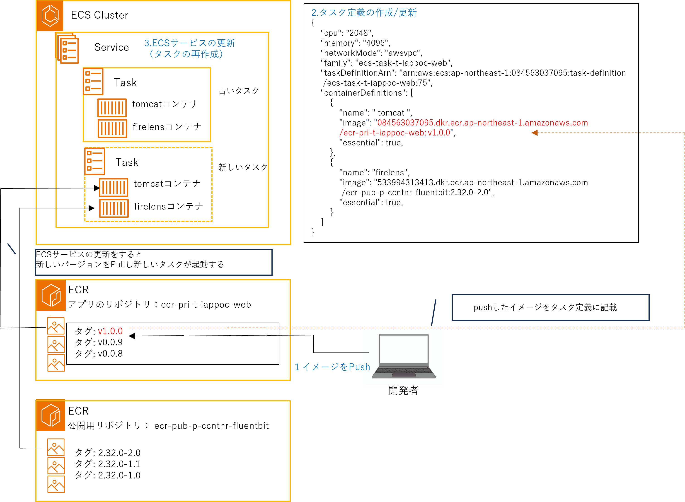

## 1.イメージのPush

### 1-1. イメージのリポジトリ名、タグ名をECR用に変更する  

```powershell
# docker tag [buildしたイメージタグ] [ECRリポジトリARN:任意のタグ名] 
docker tag app:latest 084563037095.dkr.ecr.ap-northeast-1.amazonaws.com/ecr-pri-t-iappoc-web:v1.0.0
```

{: .tip}  
**タグ名**は、アプリケーションがバージョン管理しやすいもの（例：`maven等で指定したアプリケーションのバージョン + ベースイメージのパッチ適用に対応できる値`など）を推奨します。   
[CICDテンプレート利用ガイド](/deploy/cicd/)では、`Gitのコミットハッシュ`を利用し、Gitの構成管理と一致するようにしています。  

{: .note}  
業務系共通環境基盤では、タグ名にも下記ルールが課されている時期がありましたが、現在は撤廃されています。  
`[環境種別]-[システム識別子]-[任意の文字列]`  

<br>

### 1-2．イメージをPushする  
以下、コマンドを実行します。

```powershell
# ECRへログイン
aws ecr get-login-password --region ap-northeast-1 | docker login --username AWS --password-stdin 084563037095.dkr.ecr.ap-northeast-1.amazonaws.com

# docker push [1-1で作成したイメージURI]
docker push 084563037095.dkr.ecr.ap-northeast-1.amazonaws.com/ecr-pri-t-iappoc-web:v1.0.0
```  
Push中  
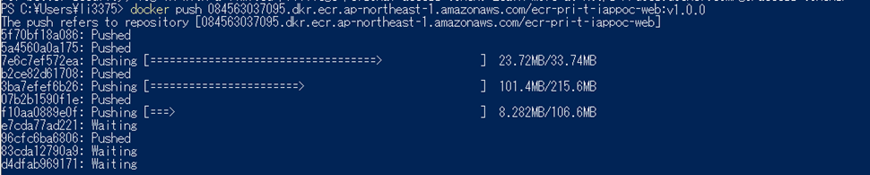  
Push後  
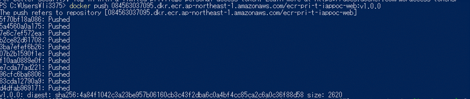  
※最後の行に、`digest`と`size`が表示されていることを確認してください。

<br>

## 2.タスク定義の更新

{: .note}  
初回作成の場合は、[ECS環境の構築手順>2.タスク定義の作成](/deploy/manual/ecs-construction.html#2タスク定義の作成)を参照してください。  

1. `ECS`を検索し、サービスを開く  
      

1. `タスク定義`を選択して、`更新したいタスク定義`を押下、表示します  
    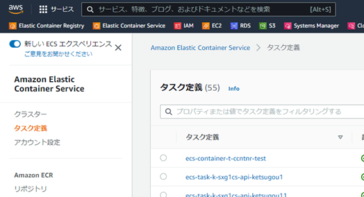  

1. `新しいリビジョンの作成`を押下します  
    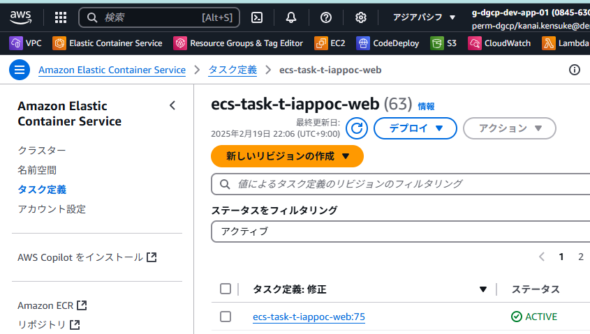  

1. `タスク定義`のパラメータを変更します  
    `例：）1-1で作成したイメージURIへ変更`  
    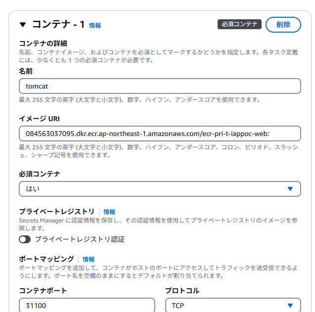  

    {: .note}  
    更新したいコンテナのイメージのURIのみを更新してください。  
    アプリを更新した場合は、Tomcatのコンテナとなります。  
    [firelens](/deploy/fluentbit/){: target="_blank"}は更新しません。  

    {: .tip}  
    ・`機密情報`に該当するもの（例：DBの認証情報など）は、アプリケーション資材には含めず、タスク定義の環境変数設定にて`Secrets Manager`か[Parameter Store](/deploy/parameterstore/)の利用を検討してください。  
    ・コンテナのポートは、コンテナ内プロセスの受付ポートと一致している必要があります。  
    ・[タスク定義頻出パラメータ](/deploy/taskdef/)を必要に応じて参照してください。  

1. `タスク定義`のパラメータの変更が完了したら、ページ下部の`作成`を押下してください。

<br>

## 3.ECSサービス(Rolling Update)の更新  
### 3-1. <u>環境変数などの外部注入の値のみ</u>反映する場合  
1. `ECS`を検索し、コンソールを開きます  
    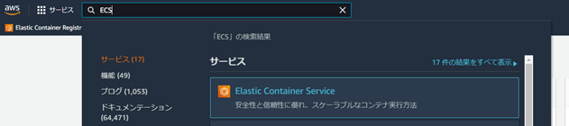  

1. `クラスター`を選択して、`更新対象のサービスのあるクラスター`を選択します  
    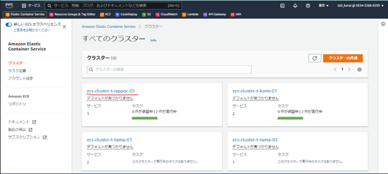  

1. タスクを更新する`サービス`にチェックボックス`✓`を入れ、`編集`を押下します  
    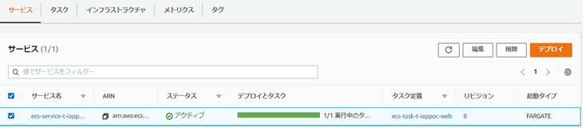  

1. `新しいデプロイの強制`にチェックボックス`✓`を入れ、`更新`を押下します  
    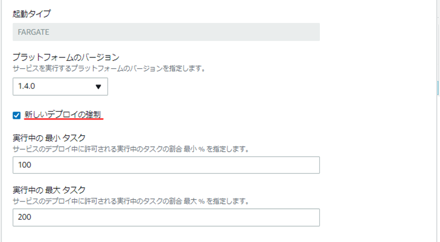  

<br>

### 3-2. タスク定義を反映する場合  
1. `ECS`を検索し、コンソールを開く  
      

1. `クラスター`を選択して、`更新対象のサービスのあるクラスター`を選択します  
      

1. タスクを更新する`サービス`にチェックボックス`✓`を入れ、`編集`を押下します  
      

1. `タスク定義`の`リビジョン`を登録したものに設定し、`更新`を押下します  
    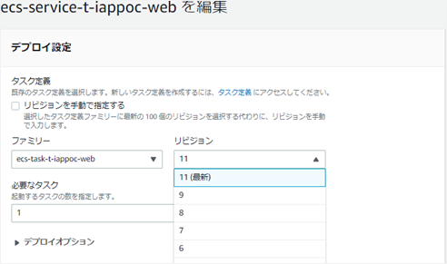  

<br>

## 4.ECSサービス(Blue/Green Deployment)の更新

{: .important}  
2025年7月頃にECSネイティブなB/G方式がサポートされ、下記に記載のCodeDeployを利用した方式は`deprecated`となっています。  
[ECSのネイティブなBlue/Greenデプロイを試してみた](https://dev.classmethod.jp/articles/ecs-blue-green/){:target="_blank"} を参照してください。  

### 4-1. <u>環境変数などの外部注入の値のみ</u>反映する場合  

{: .note}  
管理コンソールの場合のみ、タスクの再デプロイが可能です。  
※`AWS CLI`は不可  

1. `CodeDeploy`を検索し、コンソールを開く  
    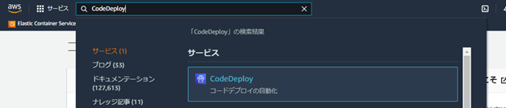  

1. `アプリケーション`を選択して、`ECSサービス`で利用している`アプリケーション`を選択します  
    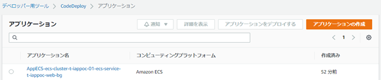  

1. `デプロイ`タブを開き、稼働中のリビジョンと同じ`デプロイＩＤ`を選択します  
    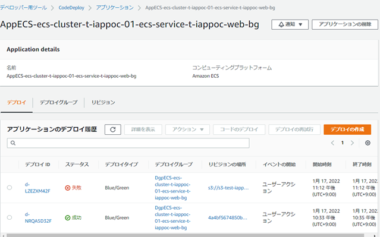  

1. `デプロイの再試行`を押下します  
    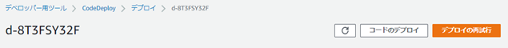  

1. 稼働確認が問題なければ、`元のタスクセットの終了`を押下し、デプロイを完了します  
      

<br>

### 4-2. タスク定義を反映する場合  

1. `CodeDeploy`を検索し、コンソールを開く  
      

1. `アプリケーション`を選択して、`ECSサービス`で利用している`アプリケーション`を選択します  
      

1. `デプロイグループ`タブを開き、`デプロイしたいECSサービス`が登録されている`デプロイグループ`を選択します  
    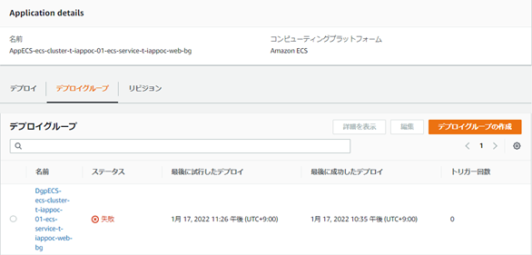  

1. `デプロイの作成`を選択します  
    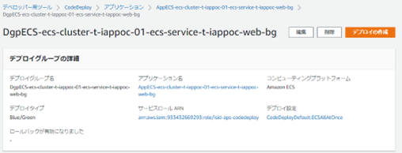  

1. リビジョンタイプで`Amazon S3`を選択し、`AppSpecファイルがあるS3バケットのパス`を記述し、`デプロイの作成`を押下します  
    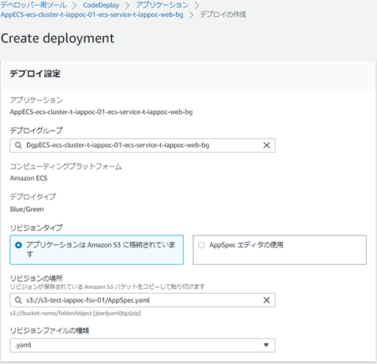  

1. 稼働確認が問題なければ、`元のタスクセットの終了`を押下し、デプロイを完了します  
    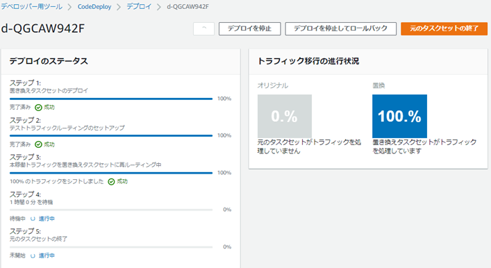  

<br>