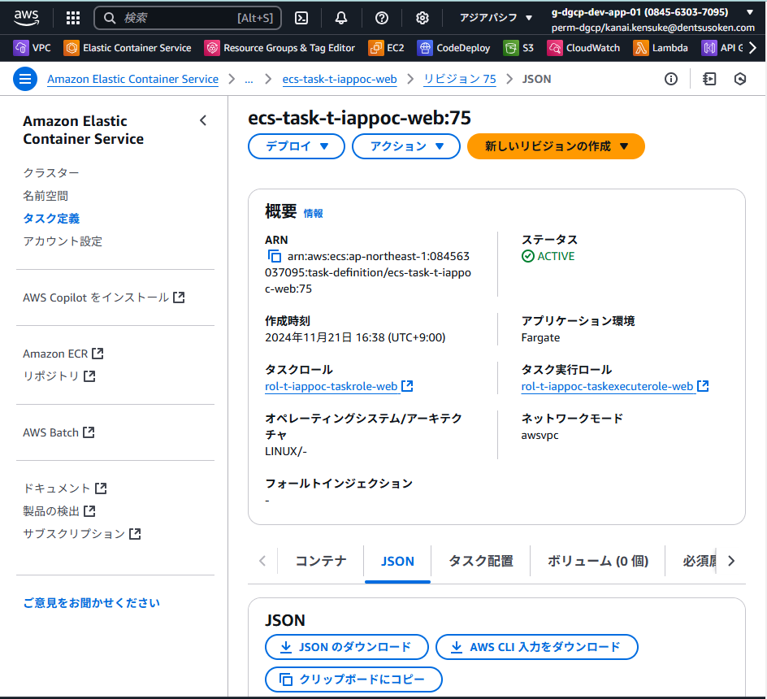
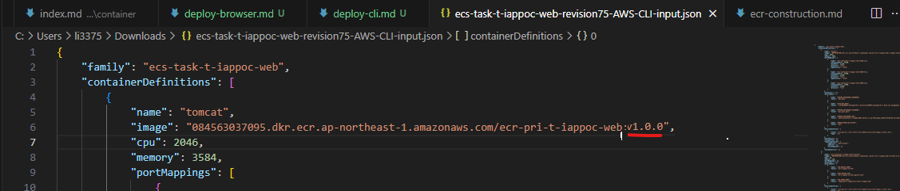
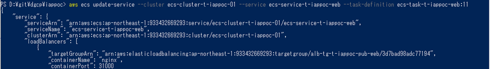
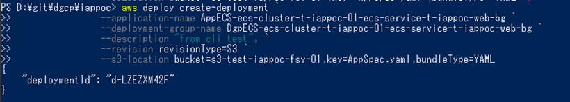

<details open markdown="block">
  <summary>
    目次
  </summary>
  {: .text-delta }

  - TOC
  {:toc}
</details>

---

<ins>補足資料</ins>
- [タスク定義頻出パラメータ](/deploy/taskdef/)
- [Systems Manager(SSM) Parameter Storeの利用](/deploy/parameterstore/)

---

{: .note}  
**本文中で作成するAWSリソース名に関して**  
・`084563037095`は `AWSアカウントID`  
・`t/p` は `非本番/本番`  
・`iappoc`は`システム識別子` を表しています。  
各アプリ側で必要な値へ置き換えてください。  

## 概念図


## 1.イメージのPush

### 1-1. イメージのリポジトリ名、タグ名をECR用に変更する  

```powershell
# docker tag [buildしたイメージタグ] [ECRリポジトリARN:任意のタグ名] 
docker tag app:latest 084563037095.dkr.ecr.ap-northeast-1.amazonaws.com/ecr-pri-t-iappoc-web:v1.0.0
```

{: .tip}  
**タグ名**は、アプリケーションがバージョン管理しやすいもの（例：`maven等で指定したアプリケーションのバージョン + ベースイメージのパッチ適用に対応できる値`など）を推奨します。   
[CICDテンプレート利用ガイド](/deploy/cicd/)では、`Gitのコミットハッシュ`を利用し、Gitの構成管理と一致するようにしています。  

{: .note}  
業務系共通環境基盤では、タグ名にも下記ルールが課されている時期がありましたが、現在は撤廃されています。  
`[環境種別]-[システム識別子]-[任意の文字列]`  

<br>

### 1-2．イメージをPushする  
以下、コマンドを実行します。

```powershell
# ECRへログイン
aws ecr get-login-password --region ap-northeast-1 | docker login --username AWS --password-stdin 084563037095.dkr.ecr.ap-northeast-1.amazonaws.com

# docker push [1-1で作成したイメージURI]
docker push 084563037095.dkr.ecr.ap-northeast-1.amazonaws.com/ecr-pri-t-iappoc-web:v1.0.0
```  
Push中  
  
Push後  
  
※最後の行に、`digest`と`size`が表示されていることを確認してください。

<br>

## 2.タスク定義の更新

{: .note}  
初回作成の場合は、[ECS環境の構築手順>2.タスク定義の作成](/deploy/manual/ecs-construction.html#2タスク定義の作成)を参照してください。  

{: .tip}  
`AWS CLI`で`タスク定義`を取得すると、そのまま登録が出来ません。  
初めてCLIで更新する場合は、管理コンソールから取得することを推奨します。  
一度取得し、Git上などで管理すれば2-1~3は、飛ばして問題ありません。

1. `ECS`を検索し、サービスを開く  
      

1. `タスク定義`を選択して、`更新したいタスク定義`を押下、`最新のリビジョン`を選択し、表示してください  
      

1. `JSONタブ`を選択し、`AWS CLI入力をダウンロード`を押下します  
      

1. `タスク定義`のパラメータを変更します  
    `例：）1-1で作成したイメージURIへ変更`  
      

    {: .note}  
    更新したいコンテナのイメージのURIのみを更新してください。  
    アプリを更新した場合は、Tomcatのコンテナとなります。  
    [firelens](/deploy/fluentbit/){: target="_blank"}は更新しません。  

    {: .tip}  
    ・`機密情報`に該当するもの（例：DBの認証情報など）は、アプリケーション資材には含めず、タスク定義の環境変数設定にて`Secrets Manager`か[Parameter Store](/deploy/parameterstore/)の利用を検討してください。  
    ・コンテナのポートは、コンテナ内プロセスの受付ポートと一致している必要があります。  
    ・[タスク定義頻出パラメータ](/deploy/taskdef/)を必要に応じて参照してください。  

1. `タスク定義`を登録します    
    ```powershell
    # aws ecs register-task-definition --cli-input-json fileb://[取得/更新したタスク定義のJSONファイルパス] 
    aws ecs register-task-definition --cli-input-json fileb://${env:HOMEPATH}\Downloads\ecs-task-t-iappoc-web.json
    ```  

    `新しいリビジョン`が作成されます。  

<br>

## 3.ECSサービス(Rolling Update)の更新  
### 3-1. 環境変数などの外部注入の値の反映  

1. `ECSサービス`を更新します  
  ```powershell
  # aws ecs update-service --cluster [ECSクラスター名] --service [ECSサービス名] --force-new-deployment  
  aws ecs update-service --cluster ecs-cluster-t-iappoc-01 --service ecs-service-t-iappoc-web --force-new-deployment  
  ```  

<br>

### 3-2. タスク定義を反映する場合   

1. `ECSサービス`を更新します  
    ```powershell
    # aws ecs update-service --cluster [ECSクラスター名] --service [ECSサービス名] --task-definition [タスク定義名]:[リビジョン]`  
    aws ecs update-service --cluster ecs-cluster-t-iappoc-01 --service ecs-service-t-iappoc-web:11 --force-new-deployment
    ```
      

### 3-3．aws ecs update-serviceの頻出パラメータ  

| オプション | 説明 |
| --- | --- |
| --task-definition | `ECSサービス`で使用する`タスク定義`を設定します。<br>基本的には`リビジョン`も含めて指定する必要があります |
| --desired-count | `ECS`が管理するサービスのタスク数。<br>稼働中のタスク数があっていない場合、`ECS`によって調整されます。 |
| --force-new-deployment | 新しいデプロイの強制。<br>外部注入側を変更した際やパッチ適用の際に実行します。 |
| --health-check-grace-period-seconds | `ELB`の`ヘルスチェックの猶予期間(秒)`。<br>コンテナの起動に時間がかかる場合は、このパラメータの設定を変更します。 |
| --enable-execute-command | `docker exec`のECS版([ECS Exec](/operation/ecsexec))。<br>`True`に設定した`ECSサービス`で作成されたタスクからコンテナ内にログイン出来ます。 |

<br>

## 4.ECSサービス(Blue/Green Deployment)の更新

{: .important}  
2025年7月頃にECSネイティブなB/G方式がサポートされ、下記に記載のCodeDeployを利用した方式は`deprecated`となっています。  
[ECSのネイティブなBlue/Greenデプロイを試してみた](https://dev.classmethod.jp/articles/ecs-blue-green/){:target="_blank"} を参照してください。  

### 4-1. タスク定義を反映する場合  

1. `AppSpecファイル`を準備し（`s3`へ配置します）、`リビジョン`は任意の値を指定します  
    ```yaml
    # 例: s3-test-iappoc-fsv-01/AppSpec.ymlを配置

    version: "0.0"
    Resources:
      - TargetService:
        Type: AWS::ECS::Service
          Properties:
            TaskDefinition: "arn:aws:ecs:ap-northeast-1:084563037095:task-definition/ecs-task-t-iappoc-web:12" #タスク定義Arn
            LoadBalancerInfo: 
              ContainerName: "ecs-container-t-iappoc-web" #LBからリクエストを受け取るコンテナ名
              ContainerPort: "31100" #LBからリクエストを受け取るポート
    ```

2. `CodeDeploy`のデプロイメントを実行します  
    ```powershell
    <#aws deploy create-deployment `
                 --application-name [アプリケーション名] `
                 --deployment-group-name [デプロイグループ名] `
                 --description [説明文], `
                 --revision revisionType=S3 `
                 --s3-location bucket=[S3バケット名],key=[ファイルへのキー],bundleType=YAML#>
    aws deploy create-deployment `
                 --application-name AppECS-ecs-clluster-t-iappoc-01-ecs-service-t-iappoc-web-bg `
                 --deployment-group-name DpgECS-ecs-clluster-t-iappoc-01-ecs-service-t-iappoc-web-bg `
                 --description "from cli test", `
                 --revision revisionType=S3 `
                 --s3-location bucket=s3-test-iappoc-fsv-01,key=AppSpec.yml,bundleTyle=YAML
    ```
      

<br>