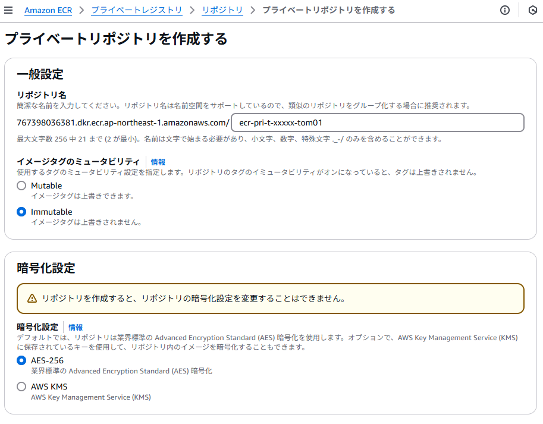
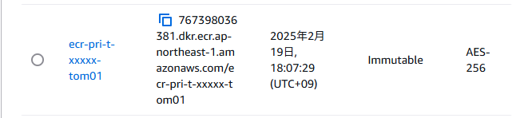

{: .tip}  
本手順をパラメータ入力だけで構築できる[テンプレート](/deploy/infrastructure/ecr.html)を公開しています。

  

    目次
  

  {: .text-delta }

  - TOC
  {:toc}

---

{: .note}  
**本文中で作成するAWSリソース名に関して**  
`t/p` は `非本番/本番` 、`xxxxxx`は`システム識別子`を表しています。  
各アプリ側で必要な値へ置き換えてください。  
本手順は、**非本番環境**での構築としています。

{: .important}  
ECRは、CI/CDパイプラインの設計と併せて構築することを推奨します。  
詳細は、[デプロイ戦略](/deploy/strategy/)を参照してください。

## 1. リポジトリの作成
 ローカルで作成した`Docker`イメージを格納するリポジトリを作成します。  
`Amazon ECR` > `プライベートレジストリ` > `リポジトリ` と遷移し、 `リポジトリを作成` を押下します。
  

| 設定項目 | 設定値 | 備考 |  
| --- | --- | --- |
| 名前 | `ecr-pri-t-xxxxxx-tom01` | - |  
| イメージタグのミュータビリティ | `Immutable` | イメージを上書きPushできるかの設定。 `Immutable(上書き不可)`に設定しないとDGCP側から確認されることがある。 |  
| 暗号化設定 | `AES-256` | 情報区分`極秘・取扱い厳重注意`の場合は、`AWS KMS`を選択してください。 |  
  
上記を設定し、`作成`を押下します。  
  
`プライベートリポジトリ`の一覧に表示されていれば完了です。  
