{: .tip}  
本手順をパラメータ入力だけで構築できる[テンプレートを公開](/deploy/infrastructure/mpa-template.html)しています。

<details open markdown="block">
  <summary>
    目次
  </summary>
  {: .text-delta }

  - TOC
  {:toc}
</details>

---

{: .note}  
**本文中で作成するAWSリソース名に関して**  
`t/p` は `非本番/本番` 、`xxxxxx`は`システム識別子`を表しています。  
各アプリ側で必要な値へ置き換えてください。  
本手順は、**非本番環境**での構築としています。

## 1.ロードバランサーの作成  
`EC2` > `ロードバランシング` > `ロードバランサー` を押下します。  
`ロードバランサーを作成` を押下します。  
1. **`Application Load Balancer` を選択**  
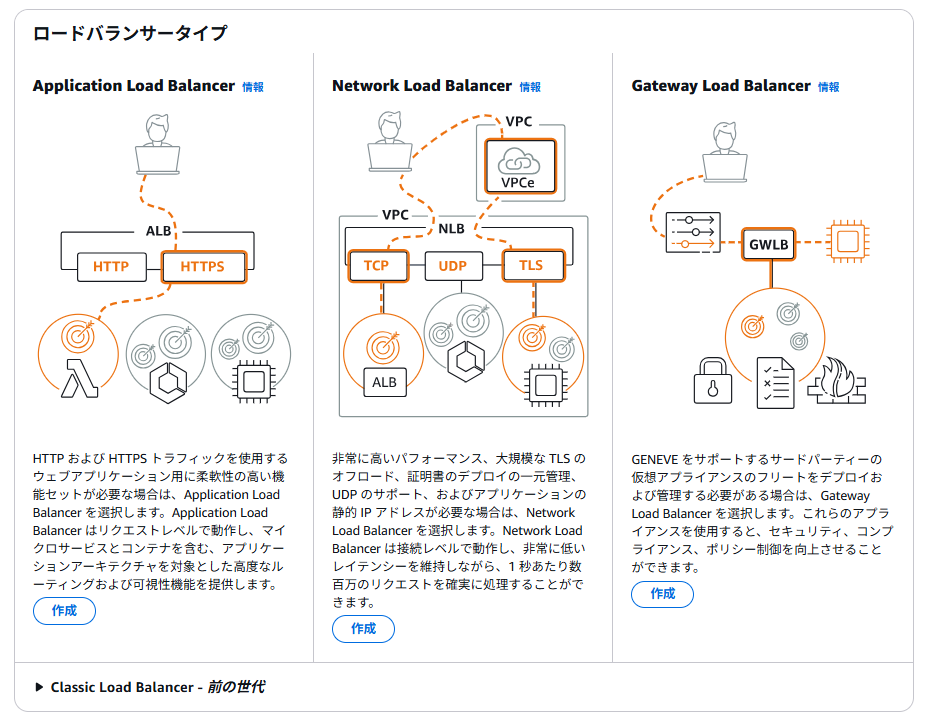   

1. **基本的な設定**  
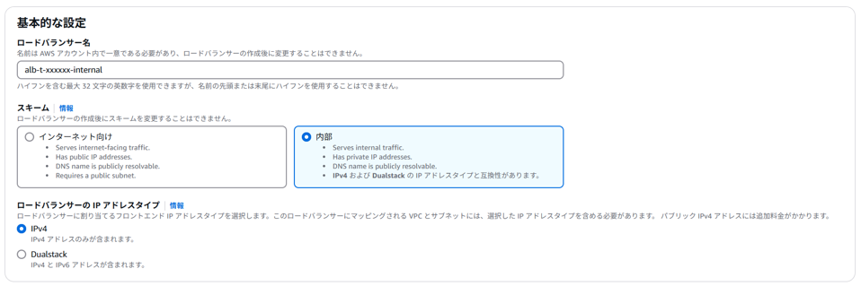   
`ロードバランサー名` を入力、スキームは `内部` を選択します。   

1. **ネットワークマッピング**  
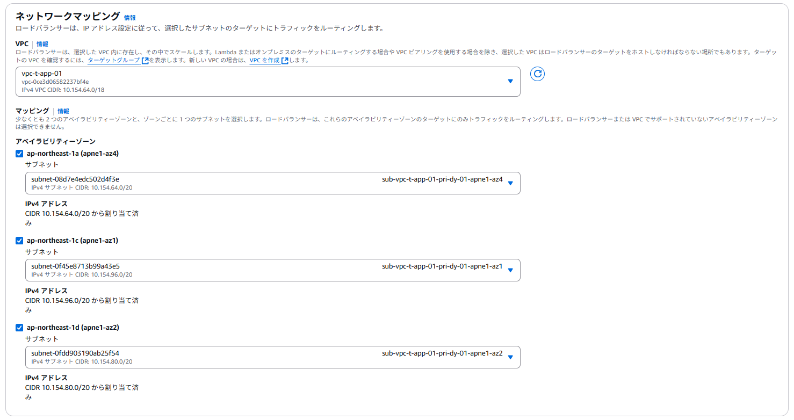  
VPC（ `vpc-t-app-01` ）を選択します。   
アベイラビリティーゾーン/サブネットで以下の3つを選択します。  

    | アベイラビリティーゾーン | サブネット | 備考 |  
    | --- | --- | --- |  
    | ap-northeast-1a | sub-vpc-t-app-01-pri-dy-01-apne1-az4 | DGCPのネットワークを利用するため |  
    | ap-northeast-1c | sub-vpc-t-app-01-pri-dy-01-apne1-az1 | DGCPのネットワークを利用するため |    
    | ap-northeast-1d | sub-vpc-t-app-01-pri-dy-01-apne1-az2 | DGCPのネットワークを利用するため |    

1. **セキュリティグループ**   
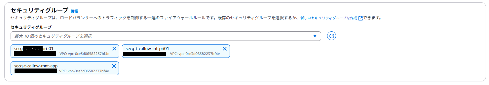   
  以下の３つを選択します。
  
    《セキュリティグループ》
    - `secg-t-<システム識別子>-pri-01`
    - `secg-t-callnw-mnt-app`
    - `secg-t-callnw-inf-pri01`
      
    {: .note}  
    各セキュリティグループの詳しい説明は、[コンテナ利用フロー > セキュリティグループ申請書](/flow/#req3){:target="_blank"}を参照してください。  

1. **リスナーとルーティング**   
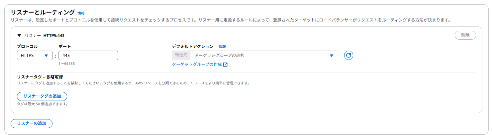  
プロトコルとポートを以下のように設定します。  

    | 設定項目 | 設定値 | 備考 | 
    | --- | --- | --- |
    | プロトコル | HTTPS | 電通のセキュリティポリシー上暗号化通信を求められるため |
    | ポート | 443 | - |

    `ターゲットグループの作成` を押下し、ターゲットグループを作成します。   


1. **ターゲットグループの作成**  
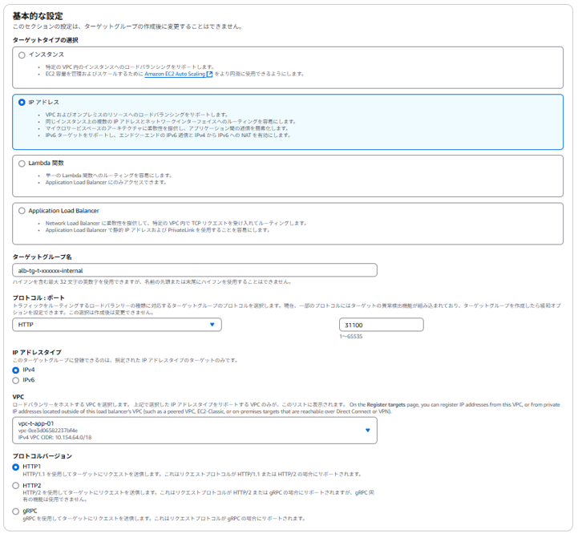  

    | 設定項目 | 設定値 | 備考 |  
    | --- | --- | --- |
    | ターゲットタイプ | IPアドレス | ECSは`IPアドレス`のみ対応するため |  
    | ターゲットグループ名 | alb-tg-t-xxxxxx-internal | - |  
    | プロトコル | HTTP1 | - |
    | ポート | 31100 | 後述で構築するコンテナがベースイメージであり、`31100`で受け付けるため |

    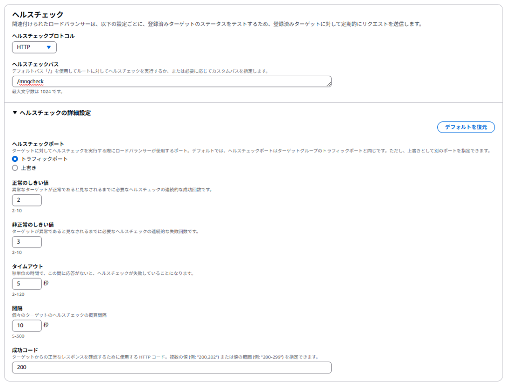  

      | 設定項目 | 設定値 | 備考 |  
      | --- | --- | --- |
      | ヘルスチェックプロトコル | HTTP | ベースイメージがHTTPにてリクエストを受け付けるため |    
      | ヘルスチェックパス | /mngcheck | ベースイメージがヘルスチェックエンドポイントを提供するため |  
      | 正常のしきい値 | 2 | DGCP標準値 | 
      | 非正常のしきい値 | 3 | DGCP標準値 | 
      | タイムアウト | 5 | DGCP標準値 |  
      | 間隔 | 10 | DGCP標準値 |  

    その他はデフォルト設定のまま `次へ` を押下します。  
    次ページの `ターゲットを登録` もデフォルトのまま、 `ターゲットグループの作成` を押下します。  
    `ロードバランサーの作成タブ` へ戻ります。  

1. **リスナーとルーティング(続き)** 
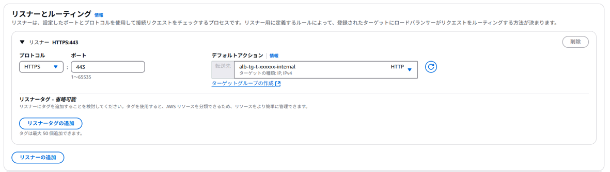  
`ターゲットグループの選択` ウィンドウ横のリロードボタン`↻` を押下し、先ほど作成したターゲットグループを選択します。

1. **セキュアリスナーの設定** 
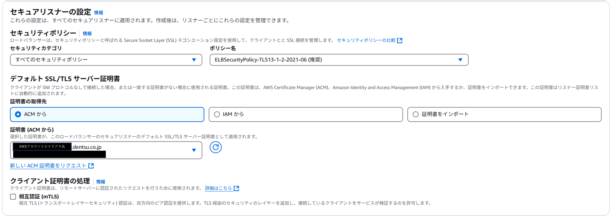  

    | 設定項目 | 設定値 |  
    | --- | --- |
    | 証明書の取得先 | ACMから |  
    | 証明書（ACMから） | `<AWSアカウントエイリアス名>.dentsu.co.jp` |  

    {: .important}  
    本手順で利用しているACM証明書はDGCPが初期構築で払い出している検証用を利用しています。  
    正式に構築する場合は、[コンテナ利用フロー > 非本番環境の構築 > ACM証明書の発行](/flow/#req4){:target="_blank"}を参照し、ACM証明書の発行とDNS申請を行ってください。  
    
    その他は、デフォルト設定。  
    `ロードバランサーの作成` を押下し、ステータスが`アクティブ`になっていることを確認します。  

1. **タグの設定**
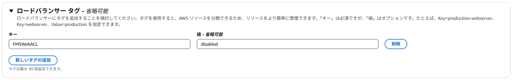  
ロードバランサータグを設定します。

    | キー | 値 | 備考 |
    | --- | --- |
    | FMSWebACL | disabled | note参照 |
    | BillingID | (DGCPから指示された値) | - | 

    {: .note}  
    DGCPでは、CS部が定義した電通WAFが自動的に適用されるようになっています。  
    しかし内部向けリソースにはWAFの適用は不要なため該当タグを付与し、WAF設定の適用外とします。  

## 2.タスク定義の作成  
ECSタスク定義の画面から `新しいタスク定義の作成（新規作成）` を押下します。  

1. タスク定義ファミリー名  
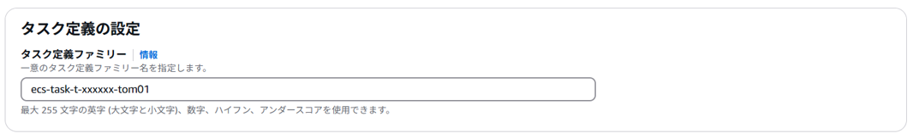  


1. インフラストラクチャの要件  

    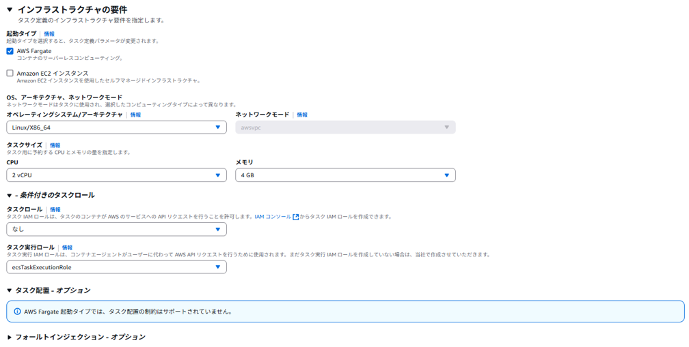  

    | 設定項目 | 設定値 | 備考 |  
    | --- | --- | --- |
    | 起動タイプ | AWS Fargate | - |  
    | OS | Linux/x86_64 | - |  
    | CPU | 2vCPU | Tomcatコンテナ標準としてマルチコアを採用（[Java17GC性能評価概要.xlsx](https://esq365.sharepoint.com/:x:/s/msteams_30dfd0/EQnuCFwXxH1GqYRsNcRPwv0BRfNz7uE04S-pWltTHOyvvw?e=d4sn7P){:target="_blank"} を参照）しているため |  
    | メモリ | 4GB | `vCPU：2`の最小メモリを選択 |  
    | タスクロール | なし | ECSのタスク定義に紐づけるIAMロール。タスク<u>稼働中</u>に利用される権限セット |
    | タスク実行ロール | ecsTaskExecutionRole | 	ECSのタスク定義に紐づけるIAMロール。タスク<u>起動時</u>に利用される権限セット |  
    
    {: .note}    
    アプリケーションの要件により、CPUとメモリの大きさを調整してください。

1. コンテナ  
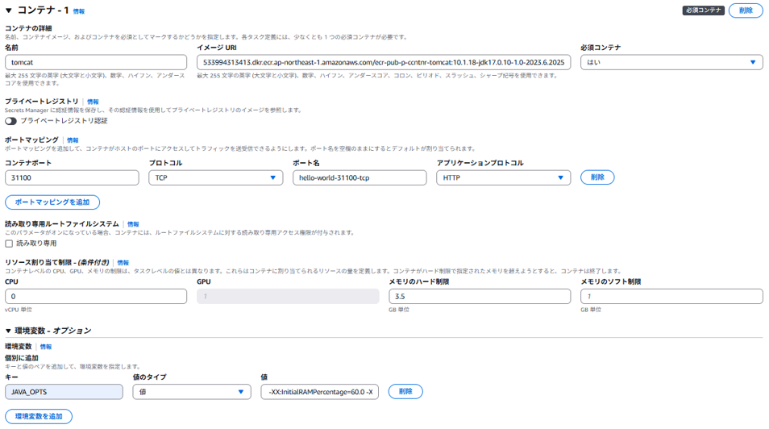    

    | 設定項目 | 設定値 | 備考 |  
    | --- | --- | --- |
    | 名前 | 《任意》 | - |  
    | イメージURI | 533994313413.dkr.ecr.ap-northeast-1.amazonaws.com/ecr-pub-p-ccntnr-tomcat:latest | ベースイメージのURI |  
    | コンテナポート | 31100 | ベースイメージで提供しているTomcatは31100を受付ポートとしているため |  
    | リソースの割り当て制限 | 3.5GB | [コンピューティングリソースの考え方](/container/resource/#5タスクのメモリリソースのサイズ検討とコンテナ毎のリソース制限について){:target="_blank"}を参照 |  
    | 環境変数（キー） | JAVA_OPTS | JVMオプションを設定するための環境変数名 |
    | 環境変数（値） | -XX:InitialRAMPercentage=80.0 -XX:MaxRAMPercentage=80.0 | [Tomcatメモリーサイジング検討](https://esq365.sharepoint.com/:x:/s/msteams_30dfd0/EZNaNSyX66pBv_g30PAtZIkB_MBDZFMIGaQsFpKeQn4Pdg?e=EkGc4y){:target="_blank"}を参照 |  
    | コンテナタイムアウト > タイムアウトを停止(`stopTimeout`) | 120 | `SIGKILL`が発出されてから強制的に削除されるまでの待機時間<br>デフォルト`30`秒 |

    {: .warning}  
    **アプリのDockerfile上にはlatestタグを使用しないでください**  
    この手順書でlatestタグを用いているのは、「手順提示のため」です。  
    アプリチームで利用する際は、バージョンが明記してあるタグ（Tomcat10の例：10.1.18-jdk17.0.10-1.0-2023.6.20250115.0）を使用し、**バージョン管理を行ってください**。  
    latestタグを利用すると、ローカルでキャッシュされたイメージを利用し、脆弱性への対応が出来なくなります。  
    GithubActionsなどでイメージのビルドを最新化する場合は、  
    ビルドの実行環境が都度、構築/イメージを取得するため、上記の限りではありません。  


    {: .tip}  
    他設定可能パラメータについては、[タスク定義頻出パラメータ](/deploy/taskdef/)を参照してください。  

1. タスク定義を登録  
    `作成ボタン` を押下し、ステータスが`ACTIVE`になっていることを確認します。  
    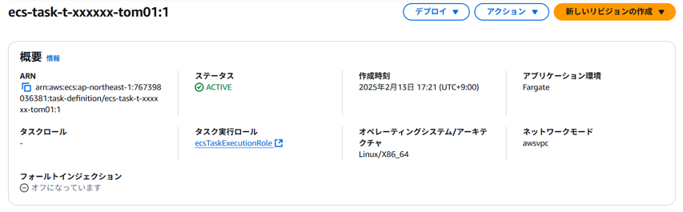  

{: .note}  
タスク定義の更新は、[ECSへのデプロイ > 2.タスク定義の更新](/deploy/manual/deploy-browser.html#2タスク定義の更新)を参照してください。  

## 3.ECS Clusterの作成
`ECS` > `クラスター` > `クラスターの作成` を押下し、以下のように設定を行います。
1. **クラスター設定**  
任意のクラスター名を入力します。  
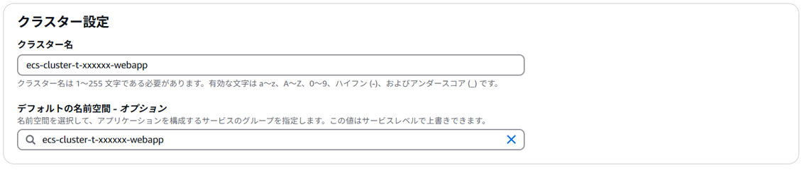  
1. **インフラストラクチャ**  
Fargateを選択する。
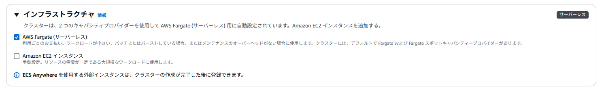  
<br>
`作成`を押下し、作成したクラスター名が表示されていることを確認します。  

## 4.ECSサービスの作成  
  `3.で作成したクラスター`を押下しステータスが`アクティブ`になっていることを確認します。その後、サービスの `作成` を押下します。  
  1. **デプロイ設定**   
  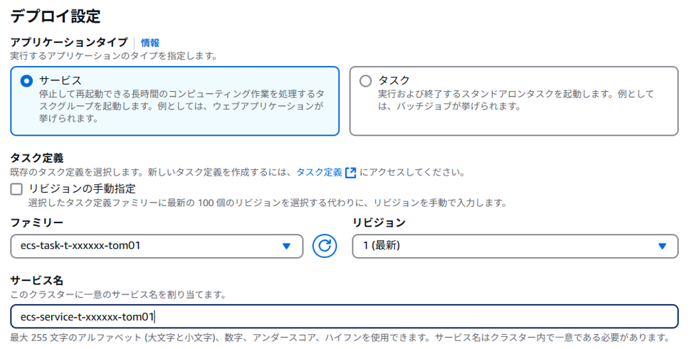  
  ファミリーを、`2.で作成したタスク定義`を選択し、任意のサービス名をつけます。他はデフォルト設定としてください。  

  1. **ネットワーキング** 
  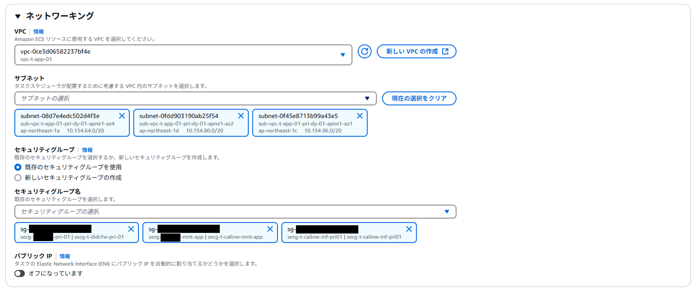 
  サブネットと、セキュリティグループを以下のように設定します。また、`パブリックIPはオフ`にします。  

      《サブネット》

      | アベイラビリティーゾーン | サブネット | 備考 |    
      | --- | --- | --- |  
      | ap-northeast-1a | sub-vpc-t-app-01-pri-dy-01-apne1-az4 | DGCPのネットワークを利用するため |    
      | ap-northeast-1c | sub-vpc-t-app-01-pri-dy-01-apne1-az1 | DGCPのネットワークを利用するため |    
      | ap-northeast-1d | sub-vpc-t-app-01-pri-dy-01-apne1-az2 | DGCPのネットワークを利用するため |    

      《セキュリティグループ》
      - `secg-t-<システム識別子>-pri-01`
      - `secg-t-callnw-mnt-app`
      - `secg-t-callnw-inf-pri01`

  1. **ロードバランシング　-オプション**  
  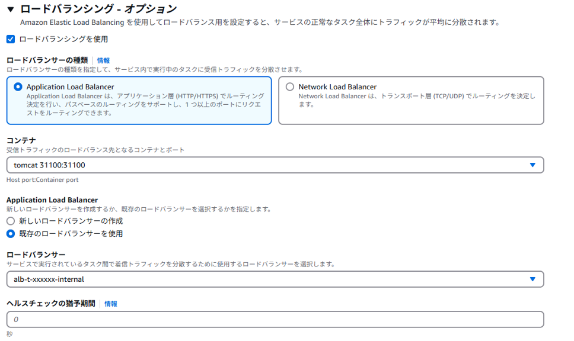  
  ロードバランサーの選択で`Application Load Balancer`を選択後、`1.で作成したロードバランサー`を選択します。  
  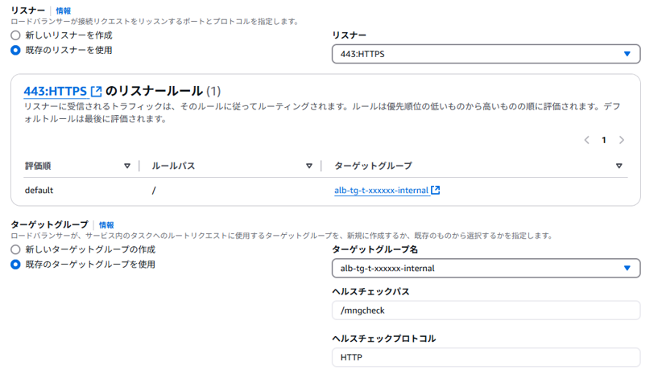  
  `リスナー`と`ターゲットグループ`についても、`1.で作成したリソース`を選択します。

  1. **タグの設定**  
  ECSサービスへタグを設定します。  
    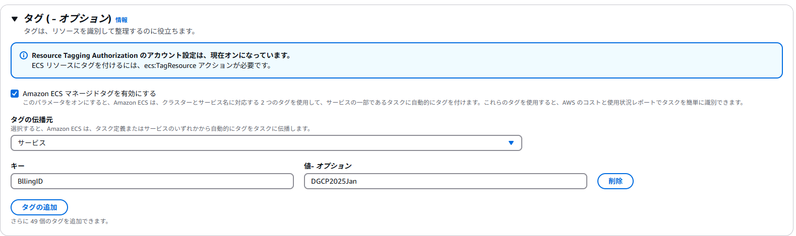  
      - `Amazon ECS マネージドタグを有効にする`に`✓`を付けます。  
      - `タグの伝播先（PropagateTags）`は、`サービス`を選択します。
      - `キー`を以下の通り設定します。  
      
        | キー | 値 | 備考 |
        | --- | --- | --- |
        | BillingID | (DGCPから指示された値) | - | 

  他はデフォルト設定とし、ページ下部の `作成` を押下します。  
<br>

## 5.動作確認 

  {: .important}  
  これから行う設定は検証用に一時的に表示させるためのものです。  
  正式に構築する場合は[コンテナ利用フロー>ACM証明書の発行](/flow/#req4)や[コンテナ利用フロー>ALBへの電通レコードの登録](/flow/#req6)を参照してください。  

  1. **正常性の確認**
  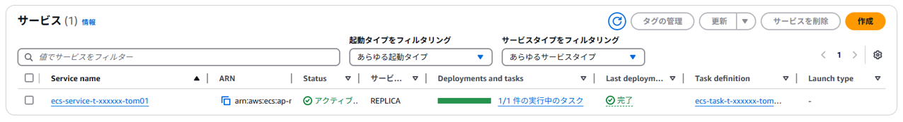
  `Status` と `Last deployment`がそれぞれ、アクティブ、完了になっていることを確認します。

  1. **DNS名のコピー**  
  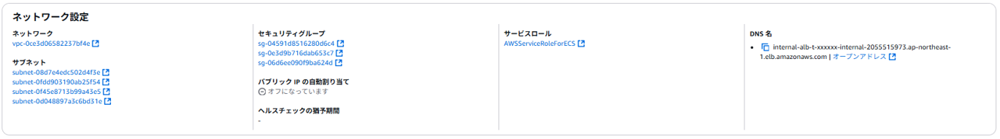  
  `ecs-service-t-xxxxxx-tom01（Service name）` > `設定とネットワーク` > `ネットワーク設定` > `DNS名` をコピーします。  

  1. **nslookup**  
  `Powershell`を用いて、以下のコマンドから`nslookup`を利用し、作成したサービスのDNSから`IPアドレス`を取得します。

      ```powershell
      #>nslookup <作成したサービスのDNS名> 
      #《入力例》
      PS C:\Users\li4524> nslookup internal-alb-t-xxxxxx-internal-2055515973.ap-northeast-1.elb.amazonaws.com
      #《出力例》
      サーバー:  isid05581.isid.co.jp
      Address:  133.158.251.107

      権限のない回答:
      名前:    internal-alb-t-xxxxxx-internal-2055515973.ap-northeast-1.elb.amazonaws.com
      Addresses:  10.154.102.88  #←取得したいIP
                10.154.70.168    #←取得したいIP
      ```

  1. **hostsファイルの設定**   
  `C:\Windows\System32\drivers\etc\hosts` 開き、ファイル末尾に以下を追加します。  

      ```powershell
      #<先ほど取得したIP> <AWSアカウントエイリアス名>.dentsu.co.jp 
      10.154.102.88 g-dgcp-dev-app-ccntnr.dentsu.co.jp
      ```

  1. **動作確認**  
  `hosts`の設定後、 `https://<AWSアカウントエイリアス名>.dentsu.co.jp/mngcheck` にアクセスします。  
  以下のような画面が表示されれば、構築完了となります。  
  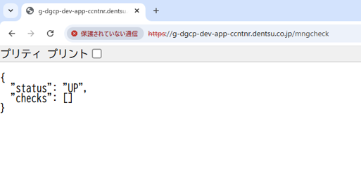  

## 6. 片付け 
  検証目的での構築の場合、AWSサービス使用料の観点より、以下のどちらかを必ず実施してください。  

  - 作成したものを残す場合  
    ECSサービスのタスク数を `0` にします。  
    
    {: .warning}  
    ECSのタスク数を`0`にしても、ALBの料金が発生します。

  - 作成したものを削除する場合  
    以下の5つを削除します。  
    1. ELB(ALB) 
    1. ターゲットグループ  
    1. ECS Cluster  
    1. ECS Service  
    1. ECS タスク定義  
 