{: .tip}  
本手順をパラメータ入力だけで構築できる[テンプレートを公開](/deploy/infrastructure/efs.html)しています。  

<details open markdown="block">
  <summary>
    目次
  </summary>
  {: .text-delta }

  - TOC
  {:toc}
</details>

---

# EFSをECSへマウントする  

{: .note}  
**本文中で作成するAWSリソース名に関して**  
`t/p` は `非本番/本番` 、`xxxxxx`は`システム識別子`を表しています。  
各アプリ側で必要な値へ置き換えてください。  
本手順は、**非本番環境**での構築としています。

本手順ではEFSをECSにマウントする方法を示します。  

## EFS
`Amazon EFS` > `ファイルシステム` > `ファイルシステムの作成` を押下します。  
ファイルシステムの名前に、任意の名前を入力し、VPCを選択、カスタマイズを押下します。  

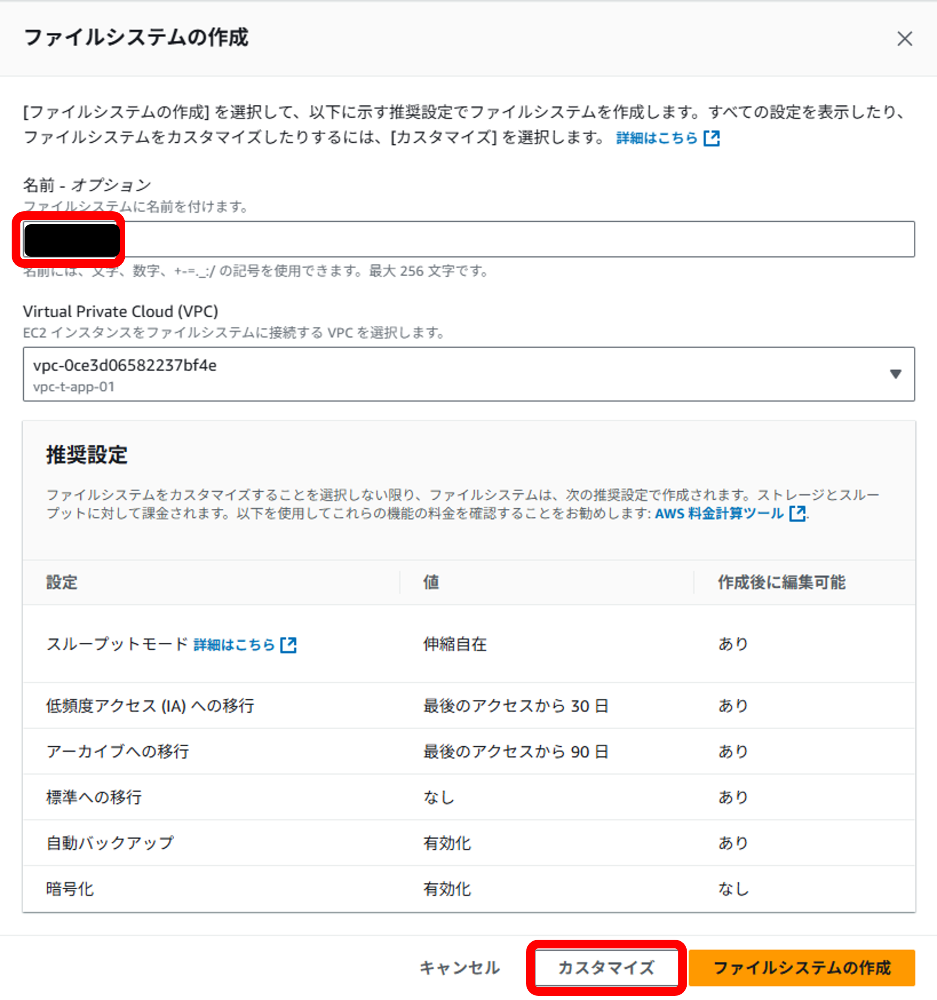  

ファイルシステムの設定ページは、要件に応じて変更してください。  

### サブネット  
ネットワークアクセス  

| アベイラビリティーゾーン | サブネット | 備考 |  
| --- | --- | --- |  
| ap-northeast-1a | sub-vpc-t-app-01-pri-st-01-apne1-az4 | DGCPのネットワークを利用するため |  
| ap-northeast-1c | sub-vpc-t-app-01-pri-st-01-apne1-az1 | DGCPのネットワークを利用するため |    
| ap-northeast-1d | sub-vpc-t-app-01-pri-st-01-apne1-az2 | DGCPのネットワークを利用するため |    

《セキュリティグループ》  
- `secg-t-<システム識別子>-pri-01`  
- `secg-t-callnw-mnt-app`  
- `secg-t-callnw-inf-pri01`  

### ファイルシステムポリシー  
ファイルシステムポリシーは空欄のまま次へを押下します。  
`作成したファイルシステム` > `ファイルシステムポリシー` > `編集` に進みます。  

以下の内容を記述してください。

```json  
{
    "Version": "2012-10-17",
    "Statement": [
        {
            "Sid": "ECS Tasks - EFS Access",
            "Effect": "Allow",
            "Principal": {
                "AWS": "arn:aws:iam::908027375710:role/rol-v-xxxxxxx" //←ECSのタスクロールを指定
            },
            "Action": [
                "elasticfilesystem:ClientRootAccess",
                "elasticfilesystem:ClientMount",
                "elasticfilesystem:ClientWrite",
                "elasticfilesystem:DescribeMountTargets",
                "elasticfilesystem:DescribeFileSystems"
            ],
            "Resource": "arn:aws:elasticfilesystem:ap-northeast-1:908027375710:file-system/fs-04c5c597dd34890a2"  //作成したファイルシステムのarnを指定  
        }
    ]
}
```  

### アクセスポイント  
作成したファイルシステムに対して[アクセスポイント](https://docs.aws.amazon.com/ja_jp/efs/latest/ug/efs-access-points.html){:target="_blank"}を作成することで、特定のディレクトリをマウント対象としたり、アクセス時のPOSIXユーザー（UID/GID）を指定することができます。  
アクセスポイントを使わずにECSにマウントすることも可能ですが、その場合はEFSのルートディレクトリ（/）がマウントされ、アクセス権限はECSタスク内の実行ユーザーに依存します。  
そのため、**基本的に1つのアクセスポイントを使用してください。**  
適切なアクセス制御やディレクトリ分離を行いたい（行える）場合は、複数アクセスポイントを作成し制御してください。   

{: .note}  
コンテナチームが標準提供するイメージは基本的に `iaptom01usr` : `iaptom_grp` で構成されています。   
こちらのユーザのIDが 5001:500 となっているため、本例示で指定しています。  

以下に、それぞれのパターンについて図解を示します。  

1. **アクセスポイントの作成、POSIXユーザーを指定した場合**  
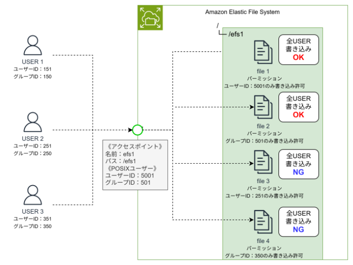  

1. **アクセスポイントの作成、POSIXユーザーを指定しない場合**  
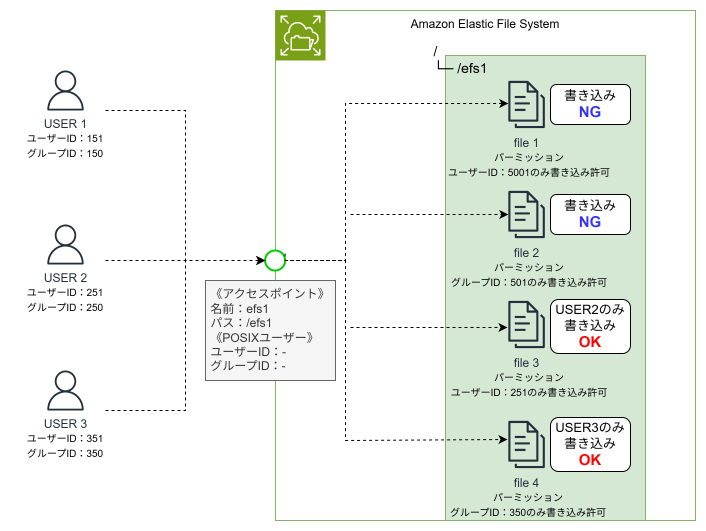  

1. **アクセスポイントを作成しない場合**  
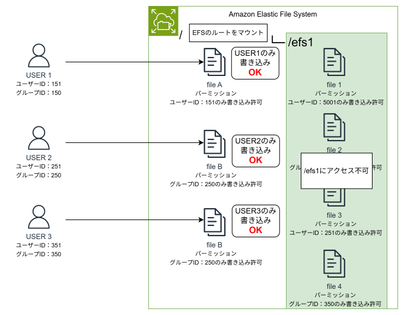  


例）Tomcatのベースイメージを使用し、アプリのログを保存する場合  

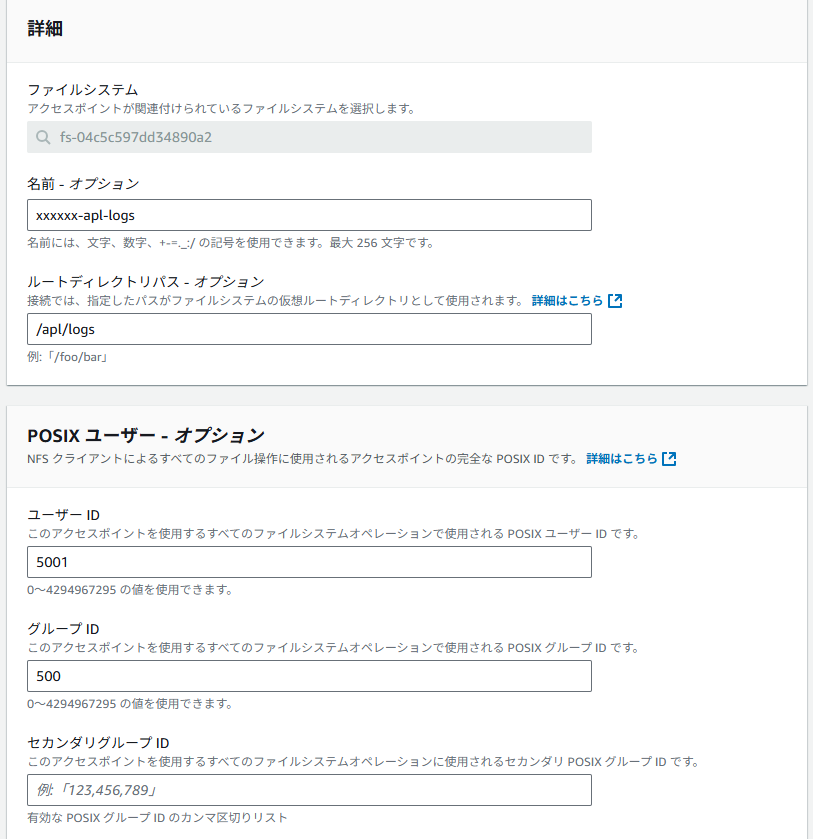  

《詳細》  

| 設定項目 | 設定値 | 備考 |  
| --- | --- | --- |  
| 名前 | 任意 | - |  
| ルートディレクトリパス | 任意 | こちらで指定したパスがルートとして扱われ、EFSの中に指定したディレクトリに書き込まれます。 |    

《POSIXユーザー》  

| 設定項目 | 設定値 | 備考 |  
| --- | --- | --- |  
| ユーザーID | コンテナ内で定義しているユーザーID | - |  
| グループID | コンテナ内で定義しているグループID | - |    
| セカンダリグループID | 任意 | - |  

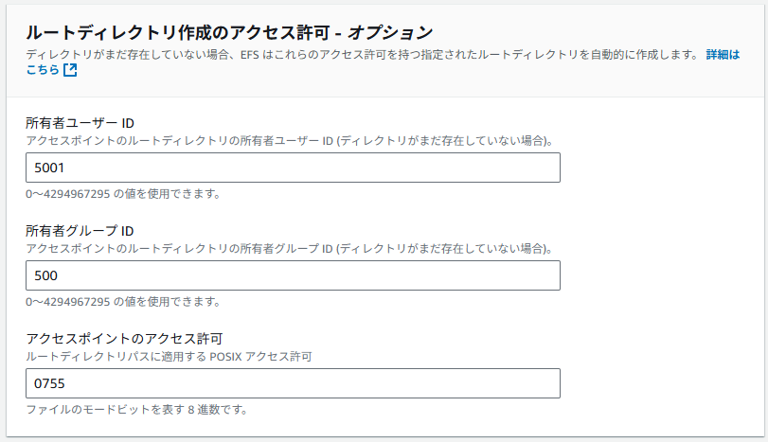  

《ルートディレクトリ作成のアクセス許可》  

| 設定項目 | 設定値 | 備考 |  
| --- | --- | --- |  
| 所有者ユーザーID | コンテナ内で定義しているユーザーID | - |  
| 所有者グループID | コンテナ内で定義しているグループID | - |    
| アクセスポイントのアクセス許可 | 0755 | パーミッション設定:rwxr-xr-x |  

`ファイルシステム` > `アクセスポイント` で作成したアクセスポイントの状態が利用可能になっていることを確認します。  

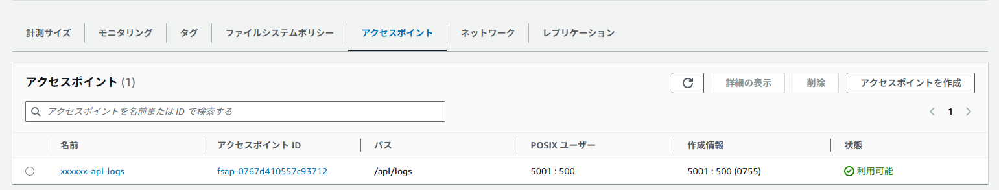  

### POSIXユーザーに、他のユーザーID、グループIDを指定したとき  
POSIXユーザーに、他のユーザーID、グループIDを指定し、ルート意外のパスを指定したときは、その指定したIDで上書きされます。  
iaptomやrootではなくなります。 
 
ex)ユーザーID（290）：グループID（10000）を指定したとき  

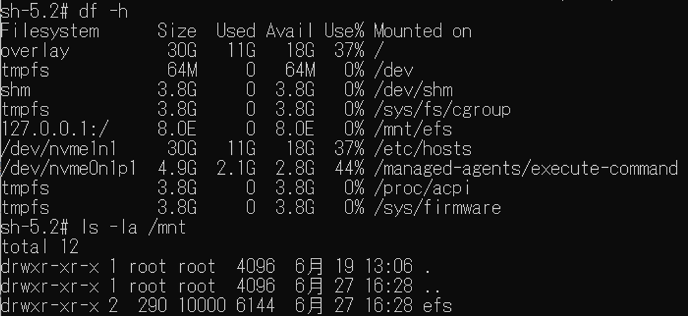  

## ECS
### ボリュームの追加  

タスク定義で新しいリビジョンを作成します。  
ストレージを追加し、ボリュームの設定を行います。  

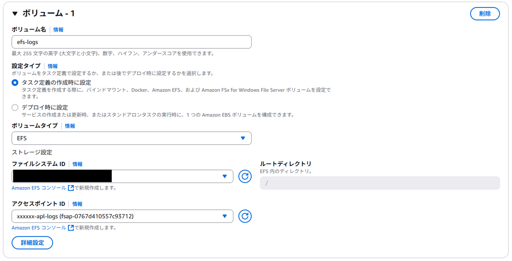  

| 設定項目 | 設定値 | 備考 |  
| --- | --- | --- |  
| ボリューム名 | 任意 | - |  
| ボリュームタイプ | EFS | - |    
| ファイルシステムID | [先ほど作成したファイルシステムID](#efs)を指定 | - |  
| アクセスポイントID | [先ほど作成したアクセスポイントID](#アクセスポイント)を指定 | - |  

その後、`詳細設定を押下`し、 `転送暗号化` と `IAM認証` を有効化します。 

  

### コンテナマウントポイント  
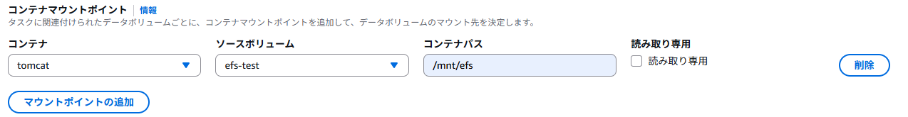  

| 設定項目 | 設定値 | 備考 |  
| --- | --- | --- |  
| コンテナ | マウントするコンテナを指定 | - |  
| ソースボリューム | [設定したボリューム名](#ボリュームの追加)を指定 | - |    
| コンテナパス | 任意 | マウントするコンテナ内のディレクトリを指定 |  

{: .warning}  
コンテナパスにファイルが格納されているディレクトリを指定すると、マウント時に上書きされます。  
空のディレクトリへマウントするように、コンテナパスを指定してください。  

### 確認  
新規作成されたタスクへ [ECS exec](https://dgcp-container-guide-public.dentsu.jp/operation/ecsexec.html){:target="_blank"}を用いてログイン。 EFSがマウントされていることを確認します。

```powershell  
#ECS exec の実行
aws ecs execute-command --cluster ＜クラスター名＞ --task ＜実行中のタスクARN＞ --container ＜コンテナ名＞ --interactive --command "/bin/sh"

#マウントされているかの確認
df -h
```  
コマンド実行後、[コンテナマウントポイント](#コンテナマウントポイント)で指定したディレクトリがマウントされていれば完了です。 

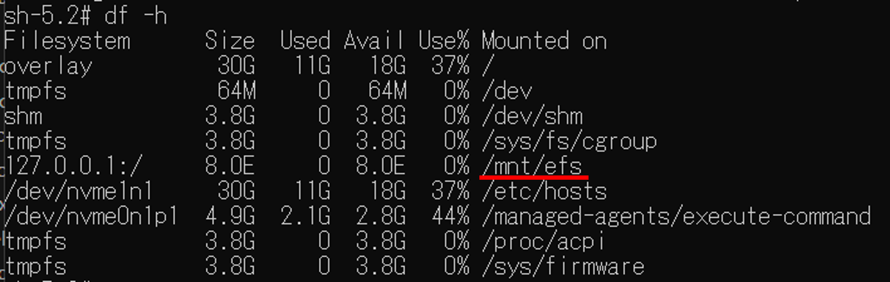  