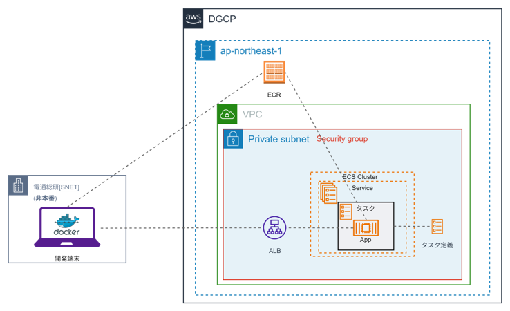
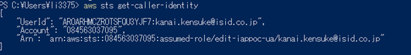
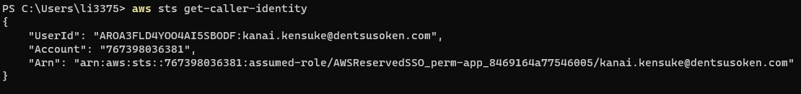
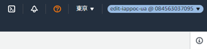
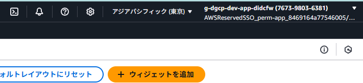

# 手動デプロイガイド

本ガイドは、DGCP上でアプリケーションを構築する際のコンテナHowToとなります。  
ECS環境の構築手順や環境への反映（デプロイ）方法について示しています。

## 概要図
  

 

## 前提

- 業務系共通環境基盤の場合、`edit-<システム識別子>-ua|u`にログインできること。
- 業務系個別環境基盤の場合、`perm-app`にログインできること。 

{: .warning}  
業務系共通環境基盤の場合、`ECS環境の構築`や`ECRの構築`は申請ベースとなります。

## 確認方法
**《AWSCLIの場合》**  
`aws sts get-caller-identity` を実行してください。  
<ins>旧基盤</ins>  
  
>業務系共通環境基盤＞スイッチロール用のツール[okta-awscli>switchRole.ps1](/tools/okta-awscli/)を提供しています。
  
<ins>新基盤</ins>  
  

**《管理コンソールの場合》**  
ブラウザ右上を確認してください。  

<ins>旧基盤</ins>  
  
<ins>新基盤</ins>  

  