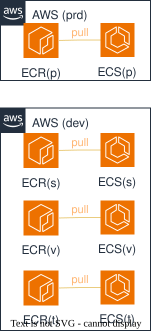
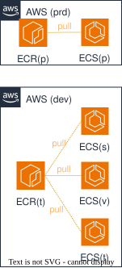
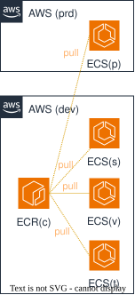
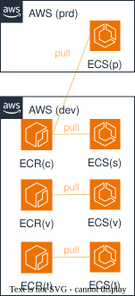
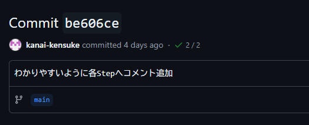
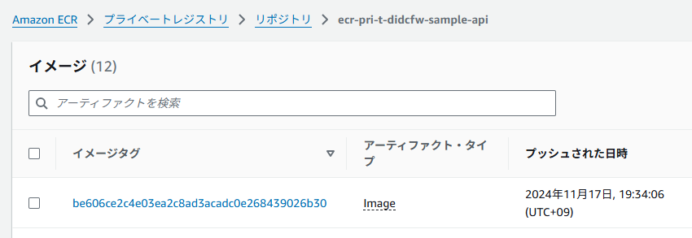
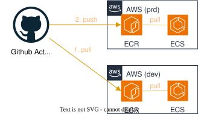
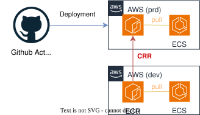
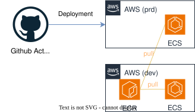
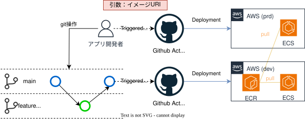

  

    目次
  

  {: .text-delta }
1. TOC
{:toc}

---

# デプロイ戦略  

{: .important}  
Gitのブランチ戦略と関連付けてデプロイ戦略を設計することが重要です。  

{: .note}  
ブランチ戦略については、以下に挙げられる有名な戦略があります。  
・[Git Flow](https://www.atlassian.com/ja/git/tutorials/comparing-workflows/gitflow-workflow){: target="_blank"}  
・[GitHub Flow](https://docs.github.com/ja/get-started/using-github/github-flow){: target="_blank"}  
・[GitLab Flow](https://about.gitlab.com/ja-jp/topics/version-control/what-is-gitlab-flow/){: target="_blank"}  
また[AWS規範ガイダンス](https://docs.aws.amazon.com/ja_jp/prescriptive-guidance/latest/choosing-git-branch-approach/visual-overview-of-the-git-hub-flow-strategy.html){: target="_blank"}等も展開されているため、参照してください。  

## ECR・ECSのデプロイ戦略方式一覧
ECR、ECSへのデプロイ戦略を各アプリチームで検討、定義してください。  
大きく4つの方式が例として挙げられます。

1. 各環境毎にECRを配置しイメージを格納、各環境のECSから利用する。
1. 非本番/本番のAWSアカウントへ1つずつECRを配置しイメージを格納、各環境のECSから利用する。
1. 1つのAWSアカウントに1つのECRを配置しイメージを格納、AWSアカウントを跨いだ各環境のECSからイメージを利用する。
1. 方式1と3を組み合わせたハイブリットにて実施する（非本番各環境+ステージング本番共通など）。

| 方式 | 概要図 | メリット | デメリット | 備考 | 
| --- | --- | --- | --- | ---| 
| 方式1（各環境） |  | ・環境分離が明確 ・誤ってイメージを削除しても各環境間の依存がないため問題ない  | 同じイメージが各環境にデプロイされているため、 ・脆弱性対応時などの棚卸が手間（同じ内容が指摘される）。 ・コスト高（AWS料金/デプロイ構築含め）。 |  | 
| 方式2（非本番/本番） |  | ・非本番と本番間の分離が明確 ・誤ってイメージを削除しても非本番/本番間の依存がないため問題ない ・方式1に比べれば、コストメリットあり。 | 同じイメージが非本番/本番環境にそれぞれデプロイされているため、 ・脆弱性対応時などの棚卸が手間（同じ内容が指摘される） |  | 
| 方式3（共通） |  | ・GitリポジトリとECRの関係が1対1となり、管理が容易。 ・方式1,2に比べ、コストメリットがある。 | 誤ってイメージを削除する可能性が高くなり、行った場合は本番影響が発生する恐れがあります。※1 | ECRの `リポジトリポリシー` の機能を利用することでAWSアカウント間を跨ぎ、イメージ利用を許可することが出来ます。  ECRを配置するAWSアカウントは、 `非本番(dev)/本番(prd)` または `作業用(com)` AWSアカウントを選択することが出来ます。 | 
| 方式4（ハイブリッド） |  | ・ステージングと本番を一致させるという観点において、他の方式よりも優れている。 | 同じイメージが各環境にデプロイされているため、 ・脆弱性対応時などの棚卸が手間（同じ内容が指摘される）。 ・コスト高（AWS料金/デプロイ構築含め）。 |　| 

※１ ECSはタスクの再作成が行われたタイミング（アプリに障害が発生し、Processが死んだなど）でイメージ取得が出来ず、障害となります。  
　　 正常稼働中に影響は発生しません。  
  

{: .tip}  
コンテナイメージのタグには、Gitコミット時に生成されるハッシュ値を利用すると、
Gitとコンテナイメージ間で関連付けでき、ECSへデプロイしているアプリの状態が分かりやすくなります。
   
*GitHubのコミット例*  
  
*ECRのイメージタグ例*  
  
  

## 本番適用の方法

ステージングでテスト済みのイメージを本番環境へ適用する運用が標準のため、3つの方法例を併せてご紹介します。  

| 方法  | 概要図 | 備考 | 
| --- | --- | --- | 
| 方法1: GitHub Actionsで指定した（非本番の）イメージを取得、本番アカウントへデプロイする  |  | 該当ワークフローの提供はございません。 | 
| 方法2: ECRの機能である `クロスアカウントレプリケーション` を利用して、自動的にステージングから本番にイメージがコピーされるように構成する |  | [ECRのクロスリージョン・クロスアカウントレプリケーションが、複製元で対象リポジトリの限定が可能に！](https://dev.classmethod.jp/articles/ecr-replicate-individual-repositories-regions-accounts/){: target="_blank"} などを参考に設定してください。  ※1 本機能は、コピー元のイメージ削除は連携されません。Push時のみ連携される仕組みです。 ※2 同一リポジトリ名で複製されるため、ECRのリポジトリ名には注意してください。 | 
| 方法3: ECRの機能である `リポジトリポリシー` を利用して、非本番のイメージを本番環境からアクセス可能とする  |  | [別AWSアカウントにあるECRリポジトリへアクセスする方法](https://dev.classmethod.jp/articles/how-to-setup-cross-account-ecr-repository-access/){: target="_blank"} などを参考に設定してください。  AWSのアカウントIDを入力するだけで設定できる[ECRのテンプレート](/deploy/infrastructure/ecr.html){: target="_blank"}を提供しています。 | 

## デプロイ戦略例  
*デプロイ戦略（方式3）例*  
  

1. 非本番環境は、 `main` へのPushをトリガーとして、ECR、ECSへのデプロイを実施する。
1. 本番環境は、`手動` をトリガーとして、ECSへのデプロイを実施する。 +
（ECRは非本番のECRでリポジトリポリシーを設定し、本番からのアクセスを許可）

## テンプレートの提供  
[CI/CDテンプレート利用ガイド](/deploy/cicd/){: target="_blank"} を参照してください。